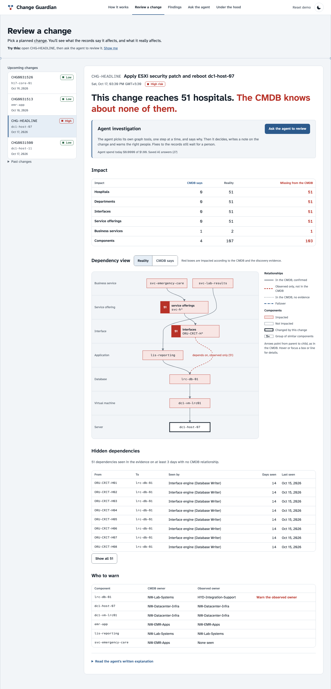
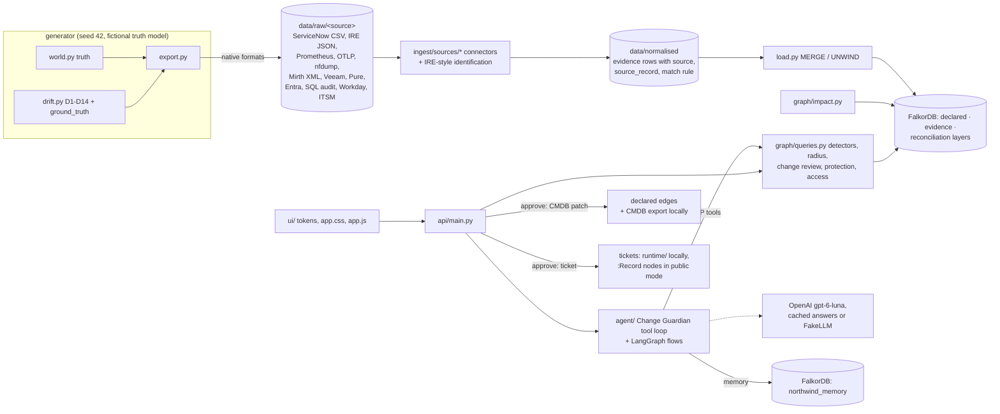
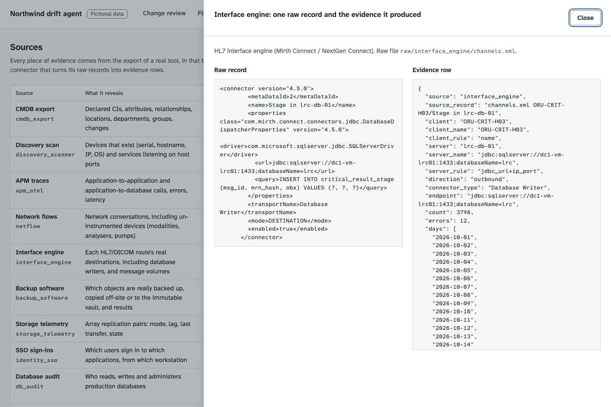
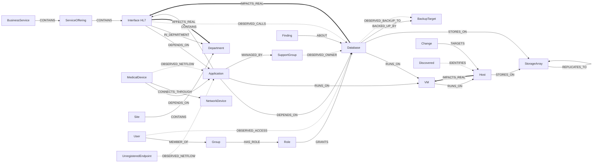
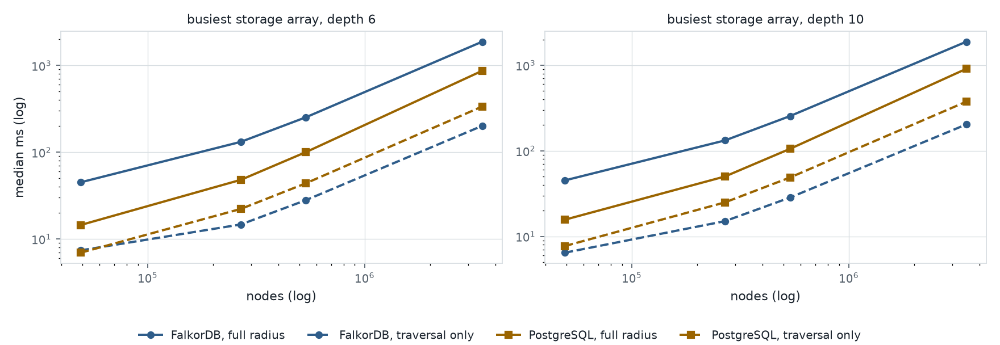
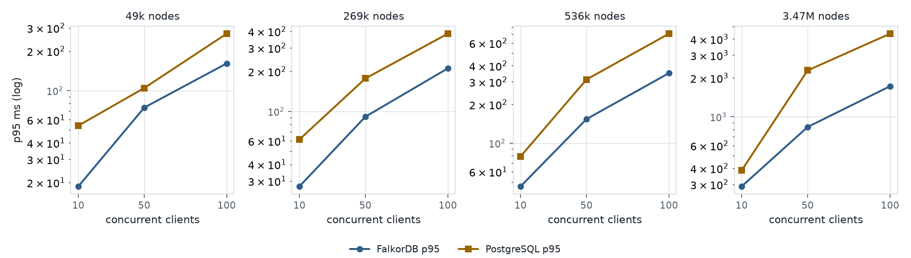

# Change Guardian

**Change Guardian** (this repository: `northwind-drift-agent`) is an AI agent on FalkorDB that checks IT changes
against what systems actually do, so a "low-risk" patch that really reaches 51 hospitals is caught before it runs.

**Live demo:** https://change-guardian.vercel.app · **Video:** https://youtu.be/FjRZv8ZxBCE · **Blog:** https://dev.to/sudarshan032/change-guardian-the-ai-agent-that-finds-what-your-it-map-forgot-1m06 ·
**MCP server:** `https://change-guardian.vercel.app/mcp`

## Rules checklist

| Required item | Where |
|---|---|
| Setup instructions | [Run](#run) (Docker, one command) and [Deploy your own](#deploy-your-own-vercel-hobby--falkordb-cloud-free-tier) |
| Graph data model | [Graph data model](#graph-data-model) (Mermaid diagram, node and edge tables), loader [`ingest/load.py`](ingest/load.py) |
| Cypher queries and graph algorithms | [Cypher the product depends on](#cypher-the-product-depends-on) (BFS, shortest path, betweenness, variable-length paths); all queries in [`graph/queries.py`](graph/queries.py), impact layer in [`graph/impact.py`](graph/impact.py) |
| Why FalkorDB | [Why FalkorDB is essential](#why-falkordb-is-essential) |
| Demo video | https://youtu.be/FjRZv8ZxBCE |
| Deployment | https://change-guardian.vercel.app ([Live demo](#live-demo): Vercel + FalkorDB Cloud) |
| Hackathon tracks | [Hackathon tracks](#hackathon-tracks) |
| AI disclosure | [AI disclosure](#ai-disclosure) |

## Check it in 5 minutes

1. **Open https://change-guardian.vercel.app and press "Watch it review a change".** A six-step guided tour replays a
   recorded agent run on the headline change (about 1 minute).
2. **Review a change → `CHG-HEADLINE`.** The CMDB says patching `dc1-host-07` touches 4 components and one
   business service; the graph says 107 components, 51 hospitals, 51 Emergency departments: risk **high**. Open
   `CHG0031513` (emr-app) for the control: low risk, CMDB and reality agree.
3. **Press "Ask the agent to review".** Every step streams: the MCP tool it chose, why, the result, time and cost.
   The public site allows a few live runs per visitor per day under a $1 daily cap; after that it replays the
   recorded run and says so.
4. **Findings → open the first finding (51 hidden links to `lrc-db-01`) → "Approve CMDB update"**, then review
   `CHG-HEADLINE` again: the risk drops to low, because the CMDB now records the 51 links. **Reset demo** (header)
   puts everything back; the demo also resets itself (see [Live demo](#live-demo)).
5. **Call the graph tools yourself** (18 read-only MCP tools, no key):

   ```bash
   curl -s https://change-guardian.vercel.app/mcp -H 'Content-Type: application/json' \
     -H 'Accept: application/json, text/event-stream' \
     -d '{"jsonrpc":"2.0","id":1,"method":"tools/call","params":{"name":"radius","arguments":{"component":"dc1-host-07","layer":"real"}}}'
   ```

   Then read [`graph/impact.py`](graph/impact.py) (the impact rules, about 90 lines) and the queries quoted in
   [Cypher the product depends on](#cypher-the-product-depends-on).

**Accuracy, measured against an answer key:** precision and recall 100% on 109 planted drifts, 0 false positives on
the 4 failover traps (and all 6 naming mismatches resolved to the right CI), on both the full data and the demo
subset (`tests/test_queries.py`, `tests/test_views.py`; answer key `ground_truth.json`, catalogue in
[Drift catalogue](#drift-catalogue)). The agent itself: 7 of 9 scenarios correct ([Agent](#agent-agent)).

## What it does

An AI agent that checks IT changes against what systems actually do. Demo hospital: Northwind Health (fictional).

**What breaks when this fails, and who do I call?** A CMDB says one thing and production does another.
This project keeps both in one FalkorDB graph: what the CMDB declares, and what traffic, scans, backups and
logins prove. It finds the drift, computes the real blast radius of a change, and explains it with paths.

> **All data is fictional.** "Northwind Health" is an invented health system, sized like a large US health
> system (51 hospitals, 1,000 clinics, 800 non-acute sites, 7 western states, two data centres, two cloud
> regions, a Hyderabad capability centre). No real organisation's systems, people, addresses or incidents
> are represented. Users are pseudonymous IDs; there are no names, emails or patients. City names are real
> places used only as locations.



**The demo moment.** `CHG-HEADLINE` patches and reboots host `dc1-host-07`. The CMDB says that touches 4
components and one business service, LIS reporting, so the change is low risk. The graph shows otherwise.
The lab results cache `lrc-db-01` runs on that host, and every hospital's critical-lab-results route to the
Emergency department stages messages in it. The real radius is 51 routes, 51 hospitals' Emergency departments
and the Emergency care business service, so the risk is **HIGH**. The CMDB also names the wrong team: the
database moved to the Hyderabad integration team.

## Why FalkorDB is essential

The product is a comparison of two graphs on the same nodes (what the CMDB declares, what the evidence shows),
walked many hops deep. Take FalkorDB out and this is what goes with it:

- **The impact layer** ([`graph/impact.py`](graph/impact.py)). Two derived edge types, `IMPACTS_DECLARED` and
  `IMPACTS_REAL`, are built by Cypher `MATCH … MERGE` rules over declared structure and observed traffic, on the
  same `:Component` nodes. Every blast radius, risk verdict and hidden-link count reads them. Without a graph store
  they become a hand-maintained closure table that must be rebuilt on every approval.
- **Traversals and algorithms in one call** ([`graph/queries.py`](graph/queries.py)): `algo.bfs` for the blast
  radius (`RADIUS`), `shortestPath` for the explanation path the UI highlights (`PATH`), variable-length patterns for
  protection gaps (`D9`, `STORES_ON|OBSERVED_BACKUP_TO|OBSERVED_REPLICATES_TO*1..6`) and common causes (`SHARED`,
  `IMPACTS_REAL*1..6`), and `algo.betweenness` for single points of failure (`CRITICAL`). The headline (host → VM →
  database → 51 routes → 51 Emergency departments → Emergency care) is one BFS over one edge type.
- **The memory graph** ([`agent/memory.py`](agent/memory.py)). The agent's investigations, steps, decisions and the
  facts people confirmed or rejected live in a second graph (`northwind_memory`) in the same FalkorDB instance,
  using FalkorDB's multi-graph support; facts point at components by name (`:Ref`), and triage reads rejected facts
  so it does not re-raise them.
- **The MCP tools** ([`agent/mcp_tools.py`](agent/mcp_tools.py)). All 18 read-only tools the agent chooses from (and
  that `/mcp` serves to any client) are thin wrappers over those Cypher queries, each with a LIMIT and a 5-second
  timeout. The agent's reasoning is only as good as these one-call graph answers.

The [benchmark](bench/RESULTS.md) measures scale trade-offs against a tuned PostgreSQL (where each is faster, how
much memory each needs); it does not test whether the product needs a graph, which follows from the model above.

## Live demo

**https://change-guardian.vercel.app** (the earlier address https://northwind-drift-agent.vercel.app still works; Vercel Hobby, function in `bom1` Mumbai; FalkorDB Cloud free tier in
AWS ap-south-1, the same region).

- It runs the demo subset (all 51 hospitals, the full drift catalogue, 6,636 components) in public mode
  (`DEPLOY_MODE=public`): nothing is generated on startup and nothing is written to disk.
- **The agent runs live** (OpenAI `gpt-6-luna`) for a few runs per visitor per day (`AGENT_VISITOR_RUNS`, default 5)
  under one daily dollar cap for the whole site (`AGENT_DAILY_USD`, $1.00). Past either limit, or when no key is set,
  it replays the recorded run for that change or incident, labelled "Recorded run". The guided tour always replays.
- **Explanations and suggested chat questions are cached:** answers recorded once with `python -m agent.prewarm`
  are bundled read-only (`deploy/llm_cache/`) and shown as "Cached AI explanation"; anything not in the bundle shows
  the rule-based explanation with a notice. Free-text chat questions get a small live allowance (15 a day for the site, 3 per visitor) under the same cap.
- Approvals work: a CMDB update changes the graph (the demo's CMDB), and tickets, notifications, the audit trail and
  an undo log are stored as `:Record` nodes in FalkorDB. **Reset demo** (header button, `POST /reset`) undoes every
  approval from the undo log, clears the records and the agent's memory, rebuilds the impact layer and re-runs triage.
- **Automatic reset.** Every visitor write (approve, reject, a live agent run) marks the demo dirty
  (`:Meta {key: 'dirty'}`). The demo resets itself once it has been dirty for an hour, and on a cold start of the
  function if an earlier instance left it dirty; both wait until nobody has written for 10 minutes, so a visitor's
  walkthrough is not reset under them. The node is deleted in the same query that claims the reset, so several
  function instances never reset twice (`api/main.py` `auto_reset`).
- **Keep-alive.** FalkorDB Cloud stops a free instance that is not used for a day and deletes it after 7 days, with
  no persistence or backups (R21). A cron-job.org job calls `GET /cron/tick` every 10 minutes, and a GitHub Actions
  schedule ([`.github/workflows/keepalive.yml`](.github/workflows/keepalive.yml)) calls it every hour as a backup:
  a graph check, the reload below if needed, then the hourly reset check. The daily Vercel cron (`/cron/reset`,
  21:00 UTC, Hobby allows once a day) still resets everything once a day.
- **Self-healing after a database restart** ([`deploy/recover.py`](deploy/recover.py)). With no persistence, a restart
  of the free instance can leave the graph empty. The demo graph counts as loaded only with its `:Meta {key: 'loaded'}`
  marker (written last) and the bundled number of components (6,636). If not, `/cron/tick`, the function's cold start
  and `/api/state` reload it from the bundled demo data (`data_demo/normalised`, `data_demo/identity`: the same load
  as `deploy.load_cloud`), then store the precomputed critical nodes, run triage and recreate the empty memory graph.
  The reload is 19 steps; each call runs as many as fit in its time budget (25-30 s, inside the 60 s function limit)
  and the next call resumes. A lease in a separate graph (`northwind_restore`) makes sure only one instance reloads.
  Meanwhile every API call answers `503 {"restarting": true}` and the site shows "The demo is restarting, back in
  about a minute", asking again every 10 seconds (which also moves the reload on) and reloading the page when it is
  back.
- `GET /api/health` reports database connectivity and latency.
- **No TLS.** FalkorDB Cloud's free tier does not offer TLS, so the live demo connects to the database
  unencrypted (username and password over plain TCP, Vercel `bom1` to AWS ap-south-1). That is acceptable only
  because every record is synthetic; for real CMDB data use a tier with TLS (Startup and above) and set
  `FALKORDB_TLS=true`.

## Run

```bash
docker compose up --build     # FalkorDB + seed (generate raw exports, run connectors, load; ~25 s) + API/UI
open http://localhost:8000    # UI; FalkorDB browser on http://localhost:3000
```

Everything works without an API key: detection, blast radius, change review, findings, approvals and the UI.
For the live agent and the AI explanations, copy `.env.example` to `.env` and set `OPENAI_API_KEYS` (default
provider, see [AI models and cost](#ai-models-and-cost)); OpenRouter free models and the Anthropic API are optional
alternatives.

Development:

```bash
uv venv --python 3.11 && uv sync --frozen
docker compose up -d falkordb
uv run python -m ingest.generate --seed 42 --out data/      # raw exports + connectors, ~15 s, ~390 MB
uv run python -m ingest.connect --data data/                 # re-run the connectors alone
uv run python -m ingest.load --data data/ --graph northwind --fresh
uv run python -m pytest -q                                   # 128 tests; agent tests use a scripted fake LLM
uv run uvicorn api.main:app --port 8000
```

### Deploy your own (Vercel Hobby + FalkorDB Cloud free tier)

1. **FalkorDB Cloud**: sign up (https://www.falkordb.com/try-free/), create a **Free** instance (pick the AWS
   region closest to your Vercel region; this demo uses ap-south-1). In the console, **Deployments → Instances →
   your instance**: the **Connectivity** tab shows the endpoint `host:port`, the **Instance Details** tab shows the
   FalkorDB user and password (**Show**). The free tier has no TLS.
2. **Load the demo subset once, from your machine**: put the four values in `.env` (gitignored) as
   `FALKORDB_HOST`, `FALKORDB_PORT`, `FALKORDB_USERNAME`, `FALKORDB_PASSWORD`, then run
   `uv run python -m deploy.load_cloud`. It tries TLS and plain connections, keeps the one that works, loads
   `data_demo/` fresh, runs triage, and prints memory per step (free tier: 100 MB).
3. **Vercel**: `npm i -g vercel`, then in the repository `vercel link` (creates the project; `.vercel/` is
   gitignored).
4. **Credentials go in Vercel, not in files**: Project → **Settings → Environment Variables** (Production), add
   `DEPLOY_MODE=public`, `FALKORDB_HOST`, `FALKORDB_PORT`, `FALKORDB_USERNAME`, `FALKORDB_PASSWORD`,
   `FALKORDB_TLS=false`, `NORTHWIND_DATA=data_demo` and `CRON_SECRET` (any random string of 16+ characters). Or from
   the CLI: `vercel env add FALKORDB_PASSWORD production` and paste the value at the prompt.
5. `vercel deploy --prod`. `vercel.json` sets the FastAPI preset, region `bom1`, a 60-second function limit, the
   files excluded from the function (full data, tests, docs, generator), and the daily reset cron;
   `.vercelignore` keeps the 390 MB data set out of the upload. The entrypoint is `index.py`.
6. Check `https://<project>.vercel.app/api/health`: `"db": "connected"`.

To refresh the cached AI answers: run `python -m agent.prewarm` locally with an OpenAI key, then
`python -m deploy.bundle_cache --from runtime/llm_cache_openai` and redeploy.

## Architecture



The LLM never writes to the CMDB or to declared edges. It reads through fixed, parameterised Cypher tools; its
actions write only records (change notes, CAB review requests, owner notifications, tickets) and flag existing
findings. A CMDB change happens only when a human approves a finding's proposed patch; everything else becomes a
ticket. Approval re-runs the detector and appends to the audit trail (`runtime/audit.jsonl` locally, `:Record` nodes
in public mode).

## Where the data comes from

Every input is the export of a real tool's documented format (sources in [RESEARCH_NOTES.md](docs/records/RESEARCH_NOTES.md) R9–R18). Each source has a
connector in `ingest/sources/<source>.py` that turns its raw files into normalised evidence; the loader loads only that.

| Source | Real-world tool it stands in for | Raw format generated | Window |
|---|---|---|---|
| `cmdb_export` | ServiceNow CMDB table export | CSV exports of `cmdb_ci`, `cmdb_rel_ci` (parent/child/type as sys_ids), `cmdb_rel_type`, `cmn_location`, `cmn_department`, `sys_user_group`, `change_request` (raw choice codes) | current state |
| `discovery_scanner` | ServiceNow Discovery / BMC Helix Discovery | IRE payload JSON `{"items": [{className, values, lookup}], "relations": [...]}` per scan batch, listening services (`tcp_port`), scan schedule | last scan per subnet |
| `apm_otel` | OpenTelemetry Collector `servicegraph` connector -> Prometheus | Prometheus text scrapes of `traces_service_graph_request_total`, `..._failed_total`, `..._request_server_seconds` histogram (`client`, `server`, `connection_type`, `failed`); OTLP/JSON span sample | 14 days (hourly demo + central, daily elsewhere) |
| `netflow` | IPFIX / NetFlow v9 collector (nfdump) | nfdump 1.7 CSV (`firstSeen, duration, proto, srcAddr, srcPort, dstAddr, dstPort, packets, bytes, flows`) + reverse-DNS/tag enrichment | 14 days |
| `interface_engine` | Mirth Connect / NextGen Connect | channel export XML (TCP Listener, TCP Sender, Database Writer with JDBC URL, DICOM Listener/Sender) + daily ChannelStatistics per connector with SOURCE metadata | 14 days |
| `backup_software` | Veeam Backup & Replication | REST `/api/v1/sessions` JSON (BackupJob, BackupCopyJob, `isStorageSnapshot`, Success/Warning/Failed) | 14 days |
| `storage_telemetry` | Pure Storage FlashArray REST 2.x | `pod-replica-links` (async: lag, recovery_point, status) and `pods` (sync) samples, hourly | 14 days |
| `identity_sso` | Microsoft Entra ID sign-in logs | Graph `signIn` JSON (userPrincipalName = bare pseudonymous ID, appDisplayName, deviceDetail, status.errorCode) | 14 days |
| `db_audit` | SQL Server Audit (`sys.fn_get_audit_file`) | audit CSV (event_time, action_id SL/UP/AL…, server_principal_name, database_name, statement) | 14 days, demo sites + GCC-HYD |
| `hr_feed` | Workday-style worker export | RaaS CSV (Employee_ID, Worker_Status, Active / Terminated / On_Leave flags, dates; no names) | current state |
| `itsm_history` | ServiceNow `incident` / `change_request` history | CSV exports with sys_id references and raw state codes | 90 days |



**HL7 interfaces.** Interfaces are CMDB CIs registered by the integration team in the custom class
`u_cmdb_ci_hl7_interface` (what real ServiceNow customers do; there is no out-of-the-box HL7 class). What the CMDB
lacks is each interface's internal destinations. Those are discovered from the interface engine's channel
configuration and statistics: the `ORU-CRIT-*` channels' Database Writer JDBC URL
(`jdbc:sqlserver://dc1-vm-lrc01:1433;databaseName=lrc`) is how the headline dependency on `lrc-db-01` is found.

## How evidence is calculated

**Identification** (all connectors, `ingest/sources/identify.py`, ServiceNow IRE order): `serial_number`, then `name`
(case-insensitive, aliases included), then `ip_address` (unique IPs only); the server end of network evidence first
tries `ip:port` against the scanner's listening services. The rule used is recorded on every row
(`match_rule` / `client_rule` / `server_rule`, `IDENTIFIES {matched_by}`). Unmatched evidence becomes an
`:UnregisteredEndpoint` (network/sign-in) or a shadow-IT candidate (discovery).

| Source | Calculation |
|---|---|
| `apm_otel` | One edge per (client, server): `count` = sum of counter increases, `errors` from the failed counter, `p95_ms` by linear interpolation inside the histogram bucket holding the 95th percentile, `days_seen` = distinct UTC days with a non-zero increase. The span sample, parsed with the standard rule (CLIENT -> SERVER span in another service, or CLIENT with `db.system` / `server.address`), agrees with the metrics for the sampled hours (test). |
| `netflow` | The server is the endpoint on a well-known or registered service port (104, 443, 636, 1433, 1972, 2575, 5000, …); an ephemeral port (≥ 49152) marks the client. Aggregated per (client CI, server CI, server port): bytes, packets, `days_seen`, first/last seen. Monitoring probes are excluded. |
| `interface_engine` | Each channel = the Interface CI of the same name. Each destination connector = an edge route -> destination (TCP Sender host:port, Database Writer JDBC host:port -> the database listening there, HTTP sender -> API). Statistics give `count` (sent), `errors` (error), `days_seen`; the source connector's SOURCE metadata gives the inbound edge from the sending system. |
| `backup_software` | Per object: `last_success` (latest Success or Warning; snapshot-only never counts), target, and Backup Copy targets (other site, immutable vault); copies also prove repository replication. A Failed job followed by a Success within 48 h is not a finding. |
| `storage_telemetry` | Per pair: mode, `max_lag_s`, last transfer, state; lag above the RPO of what the array stores for more than 1 h continuously is reported in the protection check. |
| `identity_sso` + `db_audit` | Successful sign-ins -> user -> application access; audit SELECT / DML / DDL-admin -> read / write / admin on the database (admin keeps every timestamp). Compared with MEMBER_OF -> HAS_ROLE -> GRANTS and approved change windows; employment status from `hr_feed`. |
| `itsm_history` | Observed owner = the assignment group with the most resolved incidents plus implemented changes in 90 days; ties are not reported. |

**Thresholds** (`ingest/config.py`): undocumented / unregistered traffic on ≥ 3 distinct days; backups failing = no
success in 7 days (cutoff 2026-10-07T23:59:59Z); transient failure window 48 h; ownership window 90 days; RPO breach
> 1 h; ephemeral ports ≥ 49152; snapshot end 2026-10-14T23:59:59Z (replay data, never "now").

Comparison change `CHG0031513` (planned upgrade of `emr-app`) touches far more, but the CMDB already records it all, so it is LOW risk: the risk is the gap, not the size.


A finding shows its evidence sources and whether approval patches the CMDB or raises a ticket:


## What may be written back to the CMDB

A finding may propose a **CMDB patch** only when it concerns a CI's existence, one of its CMDB attributes
(`os_version`, `serial_number`, `ip_address`, `support_group`, `status`) or a CMDB relationship. Metrics, events, job
runs, logins and lag values never go into the CMDB (`agent/approval.validate` rejects anything else).

| Finding | Action on approval |
|---|---|
| D1 undocumented dependency, D2 stale relationship, D4 retired CI still linked, D5 owner drift, D6 shadow IT (register CI), D7 ghost (retire after confirmation), D8 attribute drift, D14 unregistered app (register if approved, otherwise security ticket) | CMDB patch to the CMDB export + declared graph edges, recorded as a closed `change_request` |
| D9 protection gap, D10 backups failing | `incident` to NW-Backup-Storage |
| D11 data residency | `sn_si_incident` + compliance notification |
| D12 access drift | `sn_si_incident` |

Tickets are ServiceNow-shaped JSON (`table`, `short_description`, `cmdb_ci`, `assignment_group`, `priority`,
`category`, `description` with evidence and sources) appended to `runtime/tickets.jsonl` (in public mode, `:Record` nodes in the graph); there is no real ticketing
integration.

## Graph data model

One FalkorDB graph (`northwind`) keeps three layers apart; every node and edge has a `layer` property. Every CI is a
`:Component` plus a class label (ServiceNow / CSDM classes). The diagram shows the main shapes; solid = declared in
the CMDB, dashed = evidence from a discovery source, thick = derived by [`graph/impact.py`](graph/impact.py).



Counts are from the full data set (seed 42; 49,217 nodes, 144,016 edges including the derived impact layer). The
public demo loads a subset (all 51 hospitals, both data centres, the full drift catalogue; 6,636 components).

**Nodes**

| Label | Layer | Count | What it is |
|---|---|---|---|
| `:Component` | CMDB | 21,772 | every CI; also carries one class label below, `name`, `status`, `site`, `support_group`, `handles_phi`, `patient_safety_impact`, `aliases` |
| `:BusinessService`, `:ServiceOffering` | CMDB | 12, 204 | CSDM services; offerings are per hospital (ED critical results, Lab results, Imaging, Patient monitoring) |
| `:Application`, `:Interface`, `:Database` | CMDB | 270, 253, 79 | apps, HL7 interfaces (`ORU-CRIT-H03`, …), databases (`lrc-db-01`) |
| `:VM`, `:Host`, `:StorageArray`, `:BackupTarget` | CMDB | 247, 186, 39, 3 | infrastructure (`dc1-host-07`) |
| `:NetworkDevice`, `:MedicalDevice`, `:Endpoint`, `:EndpointGroup`, `:ExternalService` | CMDB | 9,758, 2,275, 1,664, 6,778, 4 | the rest of the estate |
| `:Site`, `:Department`, `:SupportGroup` | CMDB | 1,857, 3,526, 64 | hospitals, clinics, data centres; departments; teams |
| `:Change` | CMDB | 22 | change requests (`CHG-HEADLINE`, `CHG0031513`) |
| `:User`, `:Group`, `:Role` | CMDB (IAM) | 4,261, 6,118, 20 | pseudonymous users and their grants |
| `:Discovered` | evidence | 11,576 | discovery-scanner records (hostname, serial, IP, OS) |
| `:UnregisteredEndpoint` | evidence | 1 | traffic to something the CMDB does not know (the D14 FHIR app) |
| `:Finding` | reconciliation | 59 after triage | a drift finding with evidence, sources and a proposed patch or ticket |
| `:Record`, `:Meta`, `:Stored`, `:AgentSpend` | runtime (public mode) | small | tickets, notes, audit and undo log; data version; stored answers; daily spend |

**Edges**

| Type | Layer | Count | From → to | Meaning |
|---|---|---|---|---|
| `CONTAINS` | CMDB | 4,411 | service → offering/app/interface, app → interface, site → department | structure |
| `DEPENDS_ON {failover}` | CMDB | 3,570 | app/interface/device → app/database | declared dependency; `failover: true` never carries impact |
| `RUNS_ON`, `STORES_ON` | CMDB | 644, 178 | app/db → VM → host → array | hosting |
| `REPLICATES_TO`, `BACKED_UP_BY` | CMDB | 12, 136 | array → array, db/app → backup target | declared protection |
| `CONNECTS_THROUGH`, `LOCATED_AT`, `IN_DEPARTMENT`, `MANAGED_BY` | CMDB | 18,796, 21,772, 11,007, 21,772 | | network path, site, department, owning team |
| `MEMBER_OF`, `HAS_ROLE`, `GRANTS`, `TARGETS` | CMDB | 4,261, 6,118, 117, 22 | user → group → role → CI; change → CI | access grants, change targets |
| `OBSERVED_CALLS {source, days, count, p95_ms}` | evidence | 993 | app/interface → app/db | APM spans and interface-engine channels |
| `OBSERVED_NETFLOW {port, days}` | evidence | 2,628 | device → app | netflow |
| `OBSERVED_BACKUP_TO`, `OBSERVED_REPLICATES_TO` | evidence | 400, 12 | db/app → target, array → array | backup sessions, replica links |
| `OBSERVED_ACCESS {action}`, `OBSERVED_OWNER` | evidence | 9,780, 14,415 | user → app/db; team → CI | sign-ins and audit; who really resolves incidents |
| `IDENTIFIES {matched_by}` | reconciliation | 11,566 | discovered → CI | identification rule used (serial, name, IP) |
| `IMPACTS_DECLARED`, `IMPACTS_REAL {rule}` | derived | 5,188, 5,236 | a → b: "if a fails, b is impacted" | the two blast-radius layers |
| `AFFECTS_DECLARED`, `AFFECTS_REAL {rule}` | derived | 491, 491 | interface → consumer app / department | terminal impact (does not propagate) |
| `ABOUT` | reconciliation | | finding → CI | what a finding is about |

The agent's memory is a second graph, `northwind_memory`: `(:Investigation)-[:HAS_STEP]->(:Step)`,
`(:Investigation)-[:DECIDED]->(:Decision)`, `(:Fact)`, `(:Feedback)`, each `-[:ABOUT]->(:Ref {name})`.

**Why declared and evidence stay separate.** The gap between them is the product. Keeping both on the same nodes
makes "in the CMDB but never seen" and "seen but never declared" a single pattern match each.

**Impact layer.** `graph/impact.py` materialises one documented rule set as derived edges, built in Cypher
(`IMPACTS_DECLARED` from declared edges only, `IMPACTS_REAL` from declared structure plus evidence, terminal
`AFFECTS_*` to a route's data consumer and the departments it serves). Direction is always "if a fails, b is
impacted": runs on, stored on, depends on and observed calls propagate; a route that pushes data depends on its
source; a business service or offering is impacted when anything it contains is. Health checks, failover links and
calls into telemetry sinks never carry impact.

**The UI** (`ui/`; current design in [docs/design/DESIGN_FINAL_SPEC.md](docs/design/DESIGN_FINAL_SPEC.md), earlier [UI_SPEC.md](docs/specs/UI_SPEC.md)) answers "is this
change safe, and if not, what is the CMDB missing and who do I warn?". Every screen uses the same two colours for
the two records of the hospital: blue for what the CMDB declares, red for evidence that contradicts it. The change
review opens with a verdict sentence computed from the counts ("This change reaches 51 hospitals. The CMDB knows
about none of them."), then a CMDB-says / Reality / Missing table, the dependency view, hidden dependencies with
their source, who to warn and the AI (or rule-based) explanation. The dependency view draws tiers from business
service down to storage array with the tier names in a left gutter and arrows in CMDB direction; more than five
siblings of one class sharing the same neighbours collapse into one group box ("51 interfaces (ORU-CRIT-H*)"), so the
headline is an eight-box chain. Solid = in the CMDB and confirmed, dashed red = observed only (always labelled),
dotted = in the CMDB with no evidence, dash-dot blue = failover; impact is a red fill driven by the Reality / CMDB
says toggle. Every box and line is keyboard-focusable with a tooltip (source, counts, days seen, first and last
seen). Findings are a filterable table with a drawer (evidence, path, before/after diff or ticket preview,
"Approve CMDB update" / "Create ticket"). On phones the graph becomes the impact path as a list. Screenshots of
every page, light and dark, 1440 and 390 px: `docs/screenshots/final-design/`; earlier designs in `docs/screenshots/`.

## Drift catalogue

These cases are injected on purpose and recorded in `data/ground_truth.json`.

| Type | What it is | How many |
|---|---|---|
| D1 | Undocumented dependency | 8, including the headline: 51 routes → `lrc-db-01` |
| D2 | Stale relationship | 6 |
| D3 | Failover trap (must **not** be flagged) | 4 |
| D4 | Retired CI still linked | 3 |
| D5 | Owner drift | 6 |
| D6 | Shadow IT | 10 |
| D7 | Ghost CI | 5 |
| D8 | Attribute drift | 8 |
| D9 | Offsite protection is only same-site snapshots | 4 |
| D10 | Backups failing for more than 7 days | 3 |
| D11 | PHI replicated into cloud-central-india | 1 |
| D12 | Access with no grant path, disabled user, or admin outside a change window | 4 |
| D13 | Naming mismatch (must resolve to the same CI, not be flagged) | 5 |
| D14 | Unregistered SMART on FHIR app used by H17 cardiology | 1 |

**Measured against an answer key:** precision and recall 100% on 109 planted drifts (the D1 headline counts as its
51 links), 0 false positives on the 4 failover traps, and all 6 naming-mismatch pairs resolved to the same CI, on
both the full data and the demo subset (`tests/test_queries.py`, `tests/test_views.py`). The answer key is
`ground_truth.json`, written by the generator; a pure-Python oracle (`tests/helpers/oracle.py`) checks the same rules
independently. This shows the detectors implement the catalogue on this synthetic data, not how they would score on
a real CMDB.

## Cypher the product depends on

The eight queries below carry the product; each is quoted from the file it runs from.

**1. Build the impact layers** ([`graph/impact.py#L39-L81`](graph/impact.py#L39-L81)). One rule list per layer;
each rule becomes a `MERGE` of a derived edge. The `real` layer adds observed traffic, for example the rule that
finds the headline (an interface that writes into a database depends on it):

```cypher
MATCH (a)-[e:OBSERVED_CALLS]->(b:Interface) WHERE NOT coalesce(e.health_check, false)
WITH DISTINCT a, b WHERE a <> b
MERGE (a)-[e:IMPACTS_REAL]->(b) SET e.rule = coalesce(e.rule, 'feeds_route')
```

**2. Blast radius with BFS** ([`graph/queries.py#L48-L66`](graph/queries.py#L48-L66)), `$rel` = `IMPACTS_DECLARED`
or `IMPACTS_REAL`; the change review runs it twice and compares:

```cypher
MATCH (f:Component {name: $name})
CALL algo.bfs(f, $depth, $rel) YIELD nodes
UNWIND nodes AS n
WITH DISTINCT n
OPTIONAL MATCH (n)-[:%(term)s]->(t)
OPTIONAL MATCH (n)-[:IN_DEPARTMENT]->(nd:Department)
OPTIONAL MATCH (n)-[:LOCATED_AT]->(ns:Site)
UNWIND [CASE WHEN t:Department THEN t END, nd] AS d
OPTIONAL MATCH (ds:Site)-[:CONTAINS]->(d)
UNWIND [ds, ns] AS s
WITH collect(DISTINCT n) AS hit, collect(DISTINCT CASE WHEN NOT t:Department THEN t.name END) AS consumers,
     collect(DISTINCT d.id) AS departments,
     collect(DISTINCT CASE WHEN s.type ENDS WITH 'hospital' THEN s.id END) AS hospitals
RETURN [x IN hit | {name: x.name, label: [l IN labels(x) WHERE l <> 'Component'][0],
                    safety: x.patient_safety_impact}] AS impacted,
       consumers, departments, hospitals
```

**3. The path that explains it** ([`graph/queries.py#L99-L104`](graph/queries.py#L99-L104)), drawn in the UI and
quoted by the agent:

```cypher
MATCH (a:Component {name: $src}), (b {name: $dst})
WITH a, b, shortestPath((a)-[:%(rel)s*..10]->(b)) AS p
WHERE p IS NOT NULL
RETURN [n IN nodes(p) | coalesce(n.name, n.id)] AS nodes, [e IN relationships(p) | e.rule] AS rules
```

**4. Undocumented dependency, D1** ([`graph/queries.py#L162-L172`](graph/queries.py#L162-L172)): traffic on at least
3 distinct days with no declared dependency either way (`_FLAT` / `_DAYS` merge the per-message-type day lists):

```cypher
MATCH (a:Component)-[o:OBSERVED_CALLS|OBSERVED_NETFLOW]->(b:Component)
WHERE NOT coalesce(o.health_check, false)
WITH a, b, collect(o.days) AS dl, collect(DISTINCT o.source) AS sources
WITH a, b, sources, {_FLAT} AS flat
WITH a, b, sources, {_DAYS} AS days WHERE size(days) >= $min_days
OPTIONAL MATCH (a)-[dep:DEPENDS_ON]-(b)
WITH a, b, days, sources, count(dep) AS declared WHERE declared = 0
RETURN ['undocumented', a.name, b.name] AS key, size(days) AS days_seen, sources
ORDER BY key LIMIT $limit
```

**5. Protection gap, D9** ([`graph/queries.py#L219-L231`](graph/queries.py#L219-L231)): a patient-data system that
claims an offsite backup, but no storage, backup or replication path of up to 6 hops leaves its site:

```cypher
MATCH (c:Component)
WHERE c.status = 'operational' AND c.handles_phi = true AND c.backup_offsite = true
      AND c.backup_policy IS NOT NULL
OPTIONAL MATCH p = (c)-[:STORES_ON|OBSERVED_BACKUP_TO|OBSERVED_REPLICATES_TO*1..6]->(x:Component)
WHERE x.site <> c.site
      AND all(r IN relationships(p) WHERE type(r) <> 'OBSERVED_BACKUP_TO' OR r.last_success IS NOT NULL)
WITH c, count(x) AS offsite WHERE offsite = 0
OPTIONAL MATCH (c)-[b:OBSERVED_BACKUP_TO]->(t)
WITH c, collect(t.name) AS backup_targets
RETURN ['protection', c.name] AS key, c.site AS site, backup_targets ORDER BY key LIMIT $limit
```

**6. Common cause of a multi-site incident** ([`graph/queries.py#L483-L491`](graph/queries.py#L483-L491)): every
component that all the affected routes need. For "ED critical results delayed at H03, H17 and H22" that is 200 rows
(central apps, databases, hosts, arrays); `lrc-db-01` and `dc1-host-07` are among them, and the incident flow then
narrows them down with the changes on those components and the impact path:

```cypher
MATCH (x)-[:IMPACTS_REAL*1..6]->(r:Interface)
WHERE r.name IN $routes
WITH x, collect(DISTINCT r.name) AS hits
WHERE size(hits) = size($routes)
RETURN x.name AS component, [l IN labels(x) WHERE l <> 'Component'][0] AS label, x.site AS site,
       x.patient_safety_impact AS safety
ORDER BY label, component LIMIT $limit
```

**7. Single points of failure** ([`graph/queries.py#L422-L427`](graph/queries.py#L422-L427)), seeded so the top 10 is
the same every run (on FalkorDB Cloud the result is precomputed, see [Known limits](#known-limits)):

```cypher
CALL algo.betweenness({nodeLabels: $labels, relationshipTypes: ['OBSERVED_CALLS'], samplingSize: 5000,
                       samplingSeed: 42})
YIELD node, score
RETURN node.name AS name, [l IN labels(node) WHERE l <> 'Component'][0] AS label, score
ORDER BY score DESC, name LIMIT $limit
```

**8. What the agent remembers** ([`agent/memory.py#L107-L116`](agent/memory.py#L107-L116)), on the memory graph:

```cypher
MATCH (f:Fact)-[:ABOUT]->(r:Ref) WHERE r.name IN $n
RETURN DISTINCT f.statement, f.status, f.source, f.time, f.finding ORDER BY f.time DESC LIMIT $l
```

### All queries (`graph/queries.py`)

| Query | One line |
|---|---|
| `DETECTORS["D1"]` | Observed calls/netflow between two CIs on ≥ 3 distinct days with no declared `DEPENDS_ON` either way |
| `DETECTORS["D2"]` | Declared `DEPENDS_ON`/`REPLICATES_TO`, not failover, neither end retired, nothing observed in 14 days |
| `DETECTORS["D4"]` | Retired CI that still has CMDB relationships |
| `DETECTORS["D5"]` | Dominant `OBSERVED_OWNER` team differs from `MANAGED_BY` |
| `DETECTORS["D6"]` | `:Discovered` with no `IDENTIFIES` edge |
| `DETECTORS["D7"]` | Operational, discoverable CI in a scanned subnet, never identified, no traffic |
| `DETECTORS["D8"]` | Identified CI whose `os_version`, `serial_number` or `ip_address` differs from the scan |
| `DETECTORS["D9"]` | PHI CI claiming offsite backup whose `STORES_ON`/backup/replication paths never leave its site |
| `DETECTORS["D10"]` | CI with a backup policy and no successful backup in the last 7 days |
| `DETECTORS["D11"]` | PHI data replicated (or sent) into cloud-central-india |
| `DETECTORS["D12"]` | `OBSERVED_ACCESS` without a `MEMBER_OF → HAS_ROLE → GRANTS` path, by a disabled user, or admin outside approved `Change` windows |
| `DETECTORS["D14"]` | `:UnregisteredEndpoint` carrying traffic on ≥ 3 days |
| `ALIASES` | D13: names resolved to the same CI by serial or IP (stored in `Component.aliases`) |
| `RADIUS` | `algo.bfs` over `IMPACTS_DECLARED` or `IMPACTS_REAL`, then terminal consumers, departments, hospitals, business services |
| `PATH` / `LAST_HOP` | `shortestPath` over one impact layer, for the ordered node/rule path the UI highlights |
| `change_review` | Targets' declared vs real radius, the undocumented edges inside the real radius, and the risk (high if a high-safety service appears only in reality) |
| `UNDOCUMENTED_IN` | Observed edges inside a node set with no declared dependency (the hidden edges of a change) |
| `PROTECTION` | PHI components with no copy at another site, no copy in the immutable vault, or no recent success |
| `WHO_TO_PAGE` | Declared vs observed owner per component, flagged where they differ |
| `CRITICAL` | `algo.betweenness({nodeLabels:['Component'], relationshipTypes:['OBSERVED_CALLS'], samplingSize:5000, samplingSeed:42})`, top 10 |
| `SHARED` | Components that every given route needs (the common cause behind a multi-site symptom) |
| `RECENT_CHANGES` | Changes targeting a set of components |
| `D14_PATH` | Group → users → unregistered app → FHIR API → database |
| `NEIGHBOURHOOD` / `COMPONENT` / `SEARCH` / `EDGE_LAYERS` | Bounded lookups for the agent and UI; `EDGE_LAYERS` colours edges as observed-only, declared-only, failover or structural |

Every agent tool query has a LIMIT and a 5-second timeout; a timeout returns "query timed out" instead of
raising. FalkorDB runs with a 10-second default query timeout. On the full graph the heaviest query, D12, takes
about 0.55 s.

## Benchmark: FalkorDB vs PostgreSQL at scale

**Does it hold up at scale? Measured, not assumed** ([bench/RESULTS.md](bench/RESULTS.md)). This measures scale
trade-offs, not whether the product needs a graph (see [Why FalkorDB is essential](#why-falkordb-is-essential)). The same blast-radius questions ran on
FalkorDB and on a tuned PostgreSQL 18 (recursive CTE, prepared statements, the right indexes), on the same impact
edges, from 49k to 3.47M nodes (1,989 hospitals), in 4 GB / 4-CPU containers on one laptop. Both returned
identical answers in every case.



- **Traversal: FalkorDB is much faster inside the database.** For the largest radius (105,713 components at 3.47M
  nodes) one BFS takes 38 ms in FalkorDB against 357 ms for PostgreSQL's recursive query, and FalkorDB is 2-13x
  faster server side in every traversal case. End to end from Python with compiled reply parsers on both sides
  (hiredis, psycopg's C extension): 56 against 375 ms.
- **The full question, end to end: PostgreSQL is faster** (traversal plus consumers, departments and hospitals:
  1,324 against 908 ms at the largest radius, 60 against 30 ms for `dc1-host-07`, with hiredis). Splitting the job
  (FalkorDB traverses, PostgreSQL joins the details) was fastest for big radii (714 against 944 ms, measured
  without hiredis); for small radii PostgreSQL alone wins.
- **Under load, FalkorDB has the steadier tail** (p95 1.7 s against 4.4 s at 100 clients on 3.47M nodes, measured
  without hiredis), PostgreSQL the higher throughput (142 against 87 queries/s) and the lower median.



- **Memory is the graph's cost**: 2.6 GB in FalkorDB at 3.47M nodes, against 1.3 GB for PostgreSQL (which needs
  2.1 GB of disk instead); 5M nodes would not fit a 4 GB container.

So the case for the graph here is the model and the questions (layers on the same nodes, one-call traversals,
graph algorithms), with traversal speed that holds up; it is not a blanket speed win over a well-tuned SQL
database at these sizes. PostgreSQL also loads faster (23 s with COPY against 45 s with FalkorDB's bulk loader).

## Agent (`agent/`)

### The Change Guardian (the main actor)

Ask the agent to review a change (Change review, "Ask the agent to review") or describe a symptom (Incident).
The Change Guardian (`agent/guardian.py`) runs a tool loop: from what it has found so far it decides which tool to
call next, says why in one sentence, and stops when it has enough, with at most 10 model calls; the last call has
no tools and must return a structured verdict `{risk, root_cause, reasons, hidden_links, warn, actions,
evidence}`. Every step streams to the "Agent investigation" panel (tool, why, result, time, cost).

```
 trigger (change / symptom)
        │
        ▼
 Change Guardian ──list/call──▶ MCP client ──in process──▶ MCP server (agent/mcp_tools.py) ──▶ FalkorDB `northwind`
   (OpenAI gpt-6-luna,                                      radius, hidden_links, impact_path, who_to_page,
    Responses API)                                          protection_check, access_check, shared_dependencies,
        │                                                   changes_on, critical_nodes, get_component, get_change,
        │                                                   get_neighbourhood, search_components, findings_about,
        │                                                   stale_links, findings_by_type, unregistered_app_path, recall
        ├──▶ action tools (agent/actions.py): add_change_note, request_cab_review, notify_owner,
        │    propose_cmdb_fix (approval-gated), open_ticket ──▶ written to `northwind` at once
        ├──▶ verdict ──▶ grounding checks (numbers, CI names, most-specific shared dependency) ──▶ or rule-based
        └──▶ memory graph `northwind_memory`: Investigation, Step, Decision, Fact, Feedback ──▶ `recall` next time
```

- **MCP.** The 18 read-only tools are an MCP server: streamable HTTP at `/mcp` (live:
  `https://change-guardian.vercel.app/mcp`) and stdio (`uv run python -m agent.mcp_tools`). The agent itself
  selects tools through an MCP client connected to the same server. Action tools are not on the MCP server.
- **Memory.** Approving a finding writes a confirmed Fact, rejecting it a rejected Fact, in one shared memory graph
  (`northwind_memory`); the UI uses only this one. (The API also accepts a `user` field that keeps a caller's
  investigation history in its own graph, `northwind_memory_<user>`; approvals always go to the shared graph, and
  the UI does not use it.) The agent recalls them; triage does not re-raise a
  finding a person rejected unless its evidence changed. Try: approve the headline finding, press "Reset data, keep
  memory", and review CHG-HEADLINE again: the panel shows that a person confirmed 51 hidden links to `lrc-db-01`.
- **Cost.** Each call is priced from its token counts ($0.10 / $0.50 per 1M input / output tokens for
  gpt-6-luna); a daily cap across all keys (`AGENT_DAILY_USD`, default $1.00) and 5 live runs per visitor per day
  on the public site. When a cap is hit, the recorded run is replayed and labelled "Recorded run". Several keys can
  be given in `OPENAI_API_KEYS` (comma-separated); on a bad key, no credit or a rate limit the agent moves to the
  next and the trace says so.
- **Evaluation.** `python -m agent.eval` runs the agent live on five scenarios (`ingest/scenarios.py`); results
  in [docs/records/AGENT_EVAL.md](docs/records/AGENT_EVAL.md).

Evaluation (gpt-6-luna, run 2, live, 16 Oct): **4/5 correct**, about $0.002 per investigation.

| Scenario | Root cause | Risk | Owners warned | Grounding | Steps | Cost | Time | Actions taken |
|---|---|---|---|---|---|---|---|---|
| S1-headline | yes | yes (high) | yes | yes | 9 | $0.0032 | 36.9 s | add_change_note, request_cab_review |
| S2-backup | yes | yes (high) | yes | yes | 7 | $0.0010 | 24.5 s | open_ticket |
| S3-owner | yes | yes (medium) | yes | yes | 8 | $0.0011 | 29.1 s | notify_owner, open_ticket |
| S4-fhir-app | yes | yes (high) | yes | yes | 5 | $0.0009 | 19.2 s | open_ticket |
| S5-stale | yes | yes (low) | no | yes | 9 | $0.0021 | 31.0 s | add_change_note |

S1-S5 were used during development (run 1 scored 2/5, then 4/5 after adding `stale_links` and
`findings_by_type`). The held-out set below (D9 protection gap, D11 data residency, D12 access drift, D6 shadow IT)
was added afterwards and run once, untouched: **3/4 correct**.

| Scenario | Root cause | Risk | Owners warned | Grounding | Steps | Cost | Time | Actions taken |
|---|---|---|---|---|---|---|---|---|
| H1-protection | yes | yes (high) | yes | yes | 8 | $0.0015 | 29.5 s | open_ticket |
| H2-residency | yes | yes (high) | yes | yes | 7 | $0.0016 | 26.2 s | notify_owner, notify_owner |
| H3-access | yes | yes (high) | yes | yes | 6 | $0.0008 | 24.1 s | open_ticket |
| H4-shadow | yes | yes (medium) | no | yes | 8 | $0.0016 | 28.2 s | open_ticket |

**v2 data** (17 Oct): after the service-map fix below changed the data model (not the agent), all nine
scenarios were run once more with the same tools and prompt: **7/9 correct** (S5 and H4 miss the expected owner,
as before).

| Scenario | Root cause | Risk | Owners warned | Grounding | Steps | Cost | Time | Actions taken |
|---|---|---|---|---|---|---|---|---|
| S1-headline | yes | yes (high) | yes | yes | 9 | $0.0032 | 35.3 s | add_change_note, request_cab_review |
| S2-backup | yes | yes (high) | yes | yes | 7 | $0.0010 | 24.2 s | open_ticket |
| S3-owner | yes | yes (medium) | yes | yes | 8 | $0.0021 | 27.5 s | open_ticket |
| S4-fhir-app | yes | yes (high) | yes | yes | 5 | $0.0008 | 19.4 s | open_ticket |
| S5-stale | no | yes (low) | no | yes | 9 | $0.0023 | 30.4 s | add_change_note |
| H1-protection | yes | yes (high) | yes | yes | 8 | $0.0014 | 26.7 s | open_ticket |
| H2-residency | yes | yes (high) | yes | yes | 4 | $0.0006 | 16.7 s | open_ticket |
| H3-access | yes | yes (high) | yes | yes | 6 | $0.0009 | 24.3 s | open_ticket |
| H4-shadow | yes | yes (medium) | no | yes | 7 | $0.0012 | 25.1 s | open_ticket |

Details, both development runs and what changed: [docs/records/AGENT_EVAL.md](docs/records/AGENT_EVAL.md).

### Connect an MCP client

Claude Desktop (`claude_desktop_config.json`), local stdio server against the local stack:

```json
{"mcpServers": {"northwind-graph": {"command": "uv", "args": ["run", "--directory", "/path/to/northwind-drift-agent",
  "python", "-m", "agent.mcp_tools"], "env": {"FALKORDB_HOST": "localhost", "FALKORDB_PORT": "6379"}}}}
```

Any client that speaks streamable HTTP can use the live server: `https://change-guardian.vercel.app/mcp`
(read-only, no key). From Python: `async with mcp.Client("https://change-guardian.vercel.app/mcp") as c:
await c.list_tools()`.

### The earlier flows

These are LangGraph flows over the Cypher tools:

1. **Triage** runs every detector and groups related rows (the 51 headline rows become one finding). It
   scores each finding by patient-safety impact, real-radius size and PHI exposure. It proposes a CMDB JSON
   patch, stores the result as `(:Finding)-[:ABOUT]->(:Component)`, and returns the top 10.
2. **Change review** explains declared vs real radius, names the hidden edges, and says who to warn, preferring
   the observed owner.
3. **Incident** takes a symptom ("ED critical results delayed at H03, H17 and H22"). It finds what the
   affected routes share, then the changes on those components, then the path to the likely cause.
4. **Ambiguity** judges each D13 alias and the D14 app as "same CI, add alias", "real undocumented dependency"
   or "possible security risk, escalate". The reasons are stored on the finding.
5. **Chat** answers only through tools, cites paths, and says so when nothing was found.

All tests use a deterministic scripted LLM, so no key is needed. Live providers (`agent/llm.py`): OpenAI
`gpt-6-luna` (default), OpenRouter free models, or Claude through the official `anthropic` SDK.
Each job has a request cap: triage 1 (the top-10 explanations are one batched call), change review 1,
incident at most 6, chat at most 4 per message. The model is told its budget, and the last allowed call has
tools disabled and gets the gathered evidence as text, so it must answer; if it cannot, a rule-based summary of
the tool results (shared dependency, changes, path, owners) is shown instead.

**Grounding.** Every job passes its computed facts (counts, names, risk, tool results) as structured input and
the prompt says to use only those values. Every number and CI name in the reply is then checked against the
facts; on any mismatch the prose is discarded, the rule-based explanation is shown with a notice, and the
mismatch is logged.

We used connected components to audit the model; it found no new orphans but revealed unmapped services, which we
fixed. It is not an agent tool because no decision depends on it.

## Hackathon tracks

- **Track 1 (primary): an agent acting on connected data.** The Change Guardian investigates changes and incidents
  over one FalkorDB graph of declared and observed dependencies, chooses its tools through MCP (also served at
  `/mcp` for any MCP client), acts (work notes, CAB review, owner alerts, tickets, approval-gated CMDB fixes), and
  every answer is traceable: each step shows the tool, why, the result, time and cost, and the verdict is checked
  against the tool results.
- **Track 2: memory and shared state.** A separate memory graph across sessions (`northwind_memory`, one per CMDB
  graph, shared by everyone using the demo) holds investigations, steps, decisions, facts and feedback. The agent learns
  from people: approvals become confirmed facts it recalls in later reviews, rejections become facts that stop triage
  from re-raising the same finding.
- **Track 3: who owns what, decisions traced to sources.** Observed vs declared ownership (who really resolves
  incidents and implements changes) decides who gets warned, and every hidden link, finding and verdict points back
  to the discovery source that showed it (interface engine, netflow, APM, backup software, ITSM history, ...).

## AI models and cost

**Default: OpenAI `gpt-6-luna` for everything that uses a model.** The Change Guardian, the finding explanations
(triage), the change-review explanations, the incident flow and chat all use the same provider (`agent/llm.py`
`OpenAILLM`, Responses API, reasoning effort `low`, R22). Prices: $0.10 per 1M input tokens, $0.01 cached input,
$0.50 output.

1. Put one or more keys in `.env`: `OPENAI_API_KEYS=sk-...,sk-...` (a single `OPENAI_API_KEY` also works). The API,
   the Docker stack (`env_file`), `python -m agent.prewarm` and `python -m agent.eval` read it.
2. Optional: `AGENT_MODEL` (default `gpt-6-luna`), `AGENT_DAILY_USD` (default `1.00`), `AGENT_VISITOR_RUNS` (default 5).

**Backup keys.** The keys are tried in their fixed order: on a bad key, no credit or a rate limit (HTTP 401, 402,
403, 429) the next key is used and the trace notes "switched to backup key N". Keys are never printed or logged
(error bodies are not logged either).

**One dollar cap.** Every call is priced from its token counts and booked in FalkorDB (`:AgentSpend`), for the agent
and the other jobs together and across all keys. When today's total reaches `AGENT_DAILY_USD`, no further call is
made: jobs fall back to the rule-based explanation, the agent to its recorded run. The header shows "Agent spend
today".

**Saved answers.** Every response is cached on disk (`runtime/llm_cache_openai/`, keyed by model plus a hash of the
prompt, messages and tools). `python -m agent.prewarm` fills it once for the demo incident, triage, the demo chat
question, the six suggested chat questions and both demo change reviews, and prints what it cost; the last run
(17 Oct, demo graph) cost **$0.0063** and every answer passed the grounding checks (CHG-HEADLINE and CHG0031513
included). `python -m deploy.bundle_cache --from runtime/llm_cache_openai` copies it to `deploy/llm_cache/`, which
the public site serves read-only (`CachedLLM`, no model calls). One suggested question ("Which apps are used but not
in the CMDB?") is answered by a rule over the D6/D14 findings instead, because the model's saved answer misread
undocumented dependencies as unregistered apps (DECISIONS #93).

**Other providers (options, not the default).** `LLM_PROVIDER=openrouter` with `OPENROUTER_API_KEY` uses OpenRouter's
free models (filtered to `:free`, zero price and tool support, sent as a `models` fallback list; 50 requests a day
without credits, tracked in `runtime/llm_budget.json`; free endpoints may retain or train on prompts, acceptable only
because the data is synthetic). `ANTHROPIC_API_KEY` uses Claude through the `anthropic` SDK. `LLM_PROVIDER=fake`
(and every test) uses the scripted fake LLM. Detection, blast radius and the change review facts and risk never
depend on a model.

## API

| Method | Endpoint | Purpose |
|---|---|---|
| GET | `/health` | Service and graph status |
| GET | `/api/health` | Database connectivity and latency (503 when unreachable) |
| POST | `/reset` | Public mode: undo every approval and restore the demo |
| GET | `/cron/reset` | Same, for the daily Vercel cron (needs `Authorization: Bearer $CRON_SECRET`) |
| GET | `/cron/tick` | Keep-alive: reloads the demo graph if a restart emptied it, then the automatic reset if the demo has been dirty for an hour and idle for 10 minutes |
| GET | `/api/state` | Mode, data version, AI status and agent spend for the UI |
| POST | `/agent/investigate` | Run the Change Guardian on a change or a symptom; streams JSON lines (steps, verdict) |
| GET | `/agent/memory?components=`, `/agent/investigations`, `/agent/actions` | What the agent remembers, its past runs, the actions it took |
| GET, POST | `/mcp` | The read-only MCP server (streamable HTTP) |
| GET | `/llm` | LLM provider, models and remaining free requests today |
| POST | `/scan` | Run triage |
| GET | `/findings`, `/findings/{id}` | List findings, or one finding with its before/after diff |
| POST | `/findings/{id}/approve`, `/findings/{id}/reject` | Approve or reject a proposed patch |
| GET | `/changes` | List changes with their rule-based risk |
| POST | `/changes/{id}/review` | Change review (facts, hidden dependencies, dependency view, explanation) |
| GET | `/components/{name}/review` | What breaks if one CI fails (same shape, no LLM) |
| POST | `/incident` | Incident investigation |
| GET | `/radius?component=&layer=declared\|real` | Blast radius |
| GET | `/subgraph?component=&depth<=2` | Bounded neighbourhood for the UI |
| GET | `/critical` | Critical nodes |
| GET | `/hospitals?component=` | Hospital map, flagged by radius |
| GET | `/notifications` | Mock pages |
| POST | `/chat` | Chat |

## Data disclosure

This is synthetic data from `ingest/generate.py` with seed 42, deterministic and byte-identical across runs.
It is sized on the public footprint of a large US health system. All systems, interfaces, incidents, users
and changes are fictional. There is no personal or patient data.

Real vendor product names appear only as device models. Addresses are RFC 1918 private ranges, plus RFC 5737
documentation addresses for SaaS. Realism choices (device counts, HL7 types, DICOM, backup tiers, ServiceNow
classes) are sourced in [RESEARCH_NOTES.md](docs/records/RESEARCH_NOTES.md).

## AI disclosure

<!-- Draft written from the repository's records; the author edits the personal parts. -->

**Tools used to build it**

- **Claude Code** (Anthropic's coding agent) wrote the code, the data generator, the tests, the benchmark harness, the
  UI and most of the documentation, working from the author's specifications in [docs/specs/](docs/specs/README.md)
  and [docs/design/](docs/design/), one milestone at a time. It also ran the clean-room verifications, the benchmark
  runs, the agent evaluations and the deployments, and kept the records ([DECISIONS.md](docs/records/DECISIONS.md),
  [PROGRESS.md](docs/records/PROGRESS.md), [RESEARCH_NOTES.md](docs/records/RESEARCH_NOTES.md)).
- **Independent AI review passes** (separate agent sessions) checked the data against the specifications; their
  findings and fixes are in DECISIONS #33 and #34.
- **At runtime**, the product calls OpenAI `gpt-6-luna` for the Change Guardian, the finding explanations and chat
  (earlier versions used OpenRouter free models). The public site's explanations are recorded answers; its agent runs
  live within a daily cap. Detection, blast radius and risk never depend on a model.

**What the author did**

- **Chose the problem**: CMDB drift and change risk in a hospital system, and the headline: a "low-risk" patch whose
  real reach is 51 Emergency departments, found from the interface engine's channel configuration.
- **Designed the data**: the fictional Northwind Health world and its scale, the drift catalogue D1-D14 with its
  traps (failover links that must not be flagged, naming mismatches that must resolve), the answer key, and the
  rule that every input is a real tool's export format. Later data decisions (for example the per-hospital service
  offerings, DECISIONS #95) were the author's calls.
- **Reviewed every output**: each milestone's code, numbers, screenshots and write-ups were reviewed before moving on,
  and redirected where they were wrong or unclear.
- **Investigated the benchmark**: asked for PostgreSQL to be tuned and given a fair chance, for results to be
  reported where PostgreSQL wins, and followed up on the unexpected end-to-end numbers, which led to the client
  overhead and hiredis experiments ([bench/RESULTS.md](bench/RESULTS.md)).
- **Set the design direction**: the redesign and final design specifications (who the site is for, the landing
  story, the plain-language copy, the visual system).

Every decision is logged in [DECISIONS.md](docs/records/DECISIONS.md), including the ones the AI made on its own.

## Known limits

- The observed layer is synthetic and aggregated (hourly or daily flows). A live deployment would ingest
  OpenTelemetry, netflow and backup-tool exports.
- Impact semantics are a documented rule set, not ground truth. A data consumer, such as the EMR receiving
  results, is affected but does not propagate impact further.
- Sampling and quiet periods matter. A dependency seen on fewer than 3 days is not flagged, and failover paths
  are excluded from staleness on purpose.
- Fixes need human approval, because the observed layer can be wrong (aliases, transient traffic). Approval
  re-runs the detector to confirm the fix.
- Re-seeding resets the graph and CSVs, so approvals do not survive `docker compose up`.
- There is no auth and no multi-user support: the public demo is one shared state for every visitor (hence the
  automatic reset).
- `algo.betweenness` closed the connection on FalkorDB Cloud's free instance once (it restarted, data intact), so the
  cloud never runs it: `deploy/critical.py` computes the top 10 on a local copy of the demo subset and stores it as
  `:Meta {key: 'critical'}`, which `critical_nodes` reads first. Locally it runs live.
- The free FalkorDB Cloud instance has no persistence or backups. The keep-alive stops it being stopped for
  inactivity, and the API reloads an emptied graph by itself; agent memory, today's spend and approvals are lost in a
  restart (the demo comes back in its loaded state). If the instance itself is deleted (7 days unused), a new one
  needs new credentials in Vercel and `uv run python -m deploy.load_cloud`. GitHub runs scheduled workflows on a
  best-effort basis (they can start late) and pauses them after 60 days without commits.

## Prior art

ServiceNow Service Graph Connectors bring discovered and observed data into the CMDB. Now Assist for CMDB adds
generative assistance on top.

This project differs in three ways:
- It is open source and runs on a graph database.
- Declared and observed stay **separate layers** instead of being reconciled into one record, so the
  disagreement itself is queryable.
- Every finding and radius comes with the **exact path**, and CMDB writes happen only through approval.

## Repository

```
README.md  CLAUDE.md  LICENSE  pyproject.toml  uv.lock  Dockerfile  docker-compose.yml  vercel.json
index.py              Vercel entry point (imports the FastAPI app from api/main.py)
ingest/               truth model, raw exporters, source connectors (sources/), connector runner, loader
graph/                impact rules and Cypher queries
agent/                LLM interface, tools, findings, approval, flows, prewarm
api/                  FastAPI service
deploy/               public deployment: cloud loader, self-healing reload (recover.py), cached AI answers (llm_cache/)
.github/workflows/    hourly keep-alive for the live demo
ui/                   the web UI (tokens.css, app.css, app.js, index.html; scale/ for the Scale tab)
bench/                scale benchmark: code, RESULTS.md, charts/, results/ (raw JSON lines; archive/)
tests/                pytest suite; helpers/ holds the reference oracle, sanity queries, VERIFY generator
data_demo/            committed gzip subset: all 51 hospitals, both data centres, both cloud regions, GCC-HYD
docs/specs/           the specifications in the order they were written (README.md explains which wins)
docs/records/         decisions, research notes, report, verification, progress, the prep-session log
docs/design/          UI plan and self-critique notes
docs/screenshots/     UI screenshots (before/ holds the old UI); docs/media/ the demo recording
```

Results and the run log are in [REPORT.md](docs/records/REPORT.md), [VERIFY.md](docs/records/VERIFY.md) and
[PROGRESS.md](docs/records/PROGRESS.md). Decisions are in [DECISIONS.md](docs/records/DECISIONS.md); the benchmark
write-up is [bench/RESULTS.md](bench/RESULTS.md). Licensed under the [MIT License](LICENSE).
