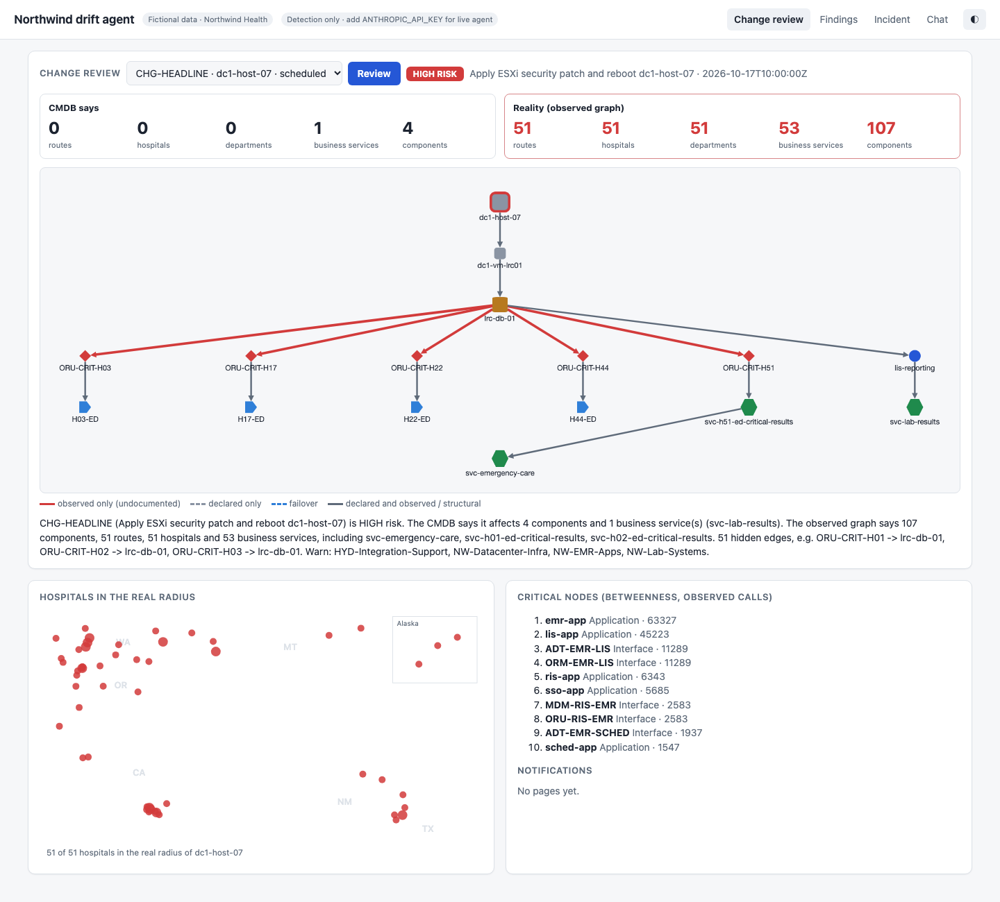
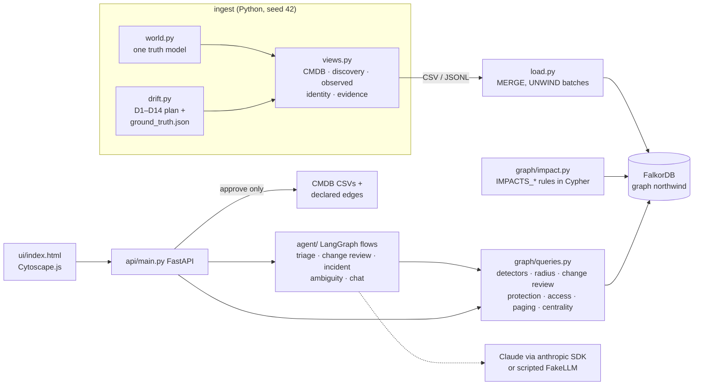

# Northwind drift agent

**What breaks when this fails, and who do I call?** A CMDB says one thing and production does another.
This project keeps both in one FalkorDB graph: what the CMDB declares, and what traffic, scans, backups and
logins prove. It finds the drift, computes the real blast radius of a change, and explains it with paths.

> **All data is fictional.** "Northwind Health" is an invented health system, sized like a large US health
> system (51 hospitals, 1,000 clinics, 800 non-acute sites, 7 western states, two data centres, two cloud
> regions, a Hyderabad capability centre). No real organisation's systems, people, addresses or incidents
> are represented. Users are pseudonymous IDs; there are no names, emails or patients. City names are real
> places used only as locations.



**The demo moment.** `CHG-HEADLINE` patches and reboots host `dc1-host-07`. The CMDB says that touches 4
components and one business service, LIS reporting, so the change is low risk. The graph shows otherwise.
The lab results cache `lrc-db-01` runs on that host, and every hospital's critical-lab-results route to the
Emergency department stages messages in it. The real radius is 51 routes, 51 hospitals' Emergency departments
and the Emergency care business service, so the risk is **HIGH**. The CMDB also names the wrong team: the
database moved to the Hyderabad integration team.

## Run

```bash
docker compose up --build     # FalkorDB + seed (generate + load, ~10 s) + API/UI
open http://localhost:8000    # UI; FalkorDB browser on http://localhost:3000
```

Everything works without an API key: detection, blast radius, change review, findings, approvals and the UI.
For the live agent (LLM explanations, incident investigation, judgement, chat), copy `.env.example` to `.env` and
set `ANTHROPIC_API_KEY`; the model defaults to `claude-sonnet-5-5` (`NORTHWIND_MODEL`).

Development:

```bash
uv venv --python 3.11 && uv sync --frozen
docker compose up -d falkordb
uv run python -m ingest.generate --seed 42 --out data/
uv run python -m ingest.load --data data/ --graph northwind --fresh
uv run python -m pytest -q          # 64 tests; all agent tests use a scripted fake LLM
uv run uvicorn api.main:app --port 8000
```

## Architecture



The LLM never writes to the CMDB or to declared edges. It reads through fixed, parameterised Cypher tools and
writes only `:Finding` nodes and mock pages. A CMDB change happens only when a human approves a finding's
proposed patch. Approval re-runs the detector and appends to `runtime/audit.jsonl`.

## Data model

Three views of one fictional estate stay separate in the graph. They meet on the same `:Component` nodes.

| View | Source files | Graph |
|---|---|---|
| **Declared** (what the CMDB says) | `cmdb/cmdb_ci.csv`, `cmdb_rel_ci.csv`, locations, departments, support groups, changes; `identity/*` | `CONTAINS`, `DEPENDS_ON {failover}`, `RUNS_ON`, `STORES_ON`, `REPLICATES_TO`, `BACKED_UP_BY`, `CONNECTS_THROUGH`, `LOCATED_AT`, `IN_DEPARTMENT`, `MANAGED_BY`, `MEMBER_OF`, `HAS_ROLE`, `GRANTS {level}`, `TARGETS` |
| **Discovered** (what scanners see) | `discovery/scan_results.jsonl`, `scan_coverage.csv` | `:Discovered` nodes, `IDENTIFIES` (by serial, else hostname + IP) |
| **Observed** (what really happens) | flows, netflow, replication, backup jobs, access log, ownership evidence | `OBSERVED_CALLS`, `OBSERVED_NETFLOW`, `OBSERVED_REPLICATES_TO`, `OBSERVED_BACKUP_TO`, `OBSERVED_ACCESS`, `OBSERVED_OWNER`; endpoints with no CMDB record become `:UnregisteredEndpoint` |

Every CI is `:Component` plus a class label: `BusinessService`, `Application`, `Interface`, `Database`, `VM`,
`Host`, `StorageArray`, `BackupTarget`, `NetworkDevice`, `MedicalDevice`, `Endpoint`, `EndpointGroup` or
`ExternalService`.

The full data set has 49k nodes and 150k edges. Relationship types follow ServiceNow:
`Provides storage for::Stored on` and `Connects to::Connected by` are standard; `Replicates to` and
`Backed up by` are documented custom types.

**Why declared and observed stay separate.** The gap between them is the product. Merging them would hide the
lie. Keeping both on the same nodes makes "in the CMDB but never seen" and "seen but never declared" a single
pattern match each.

**Impact layer.** `graph/impact.py` materialises one documented rule set as derived edges, built in Cypher:
- `IMPACTS_DECLARED` uses declared edges only.
- `IMPACTS_REAL` uses declared structure plus observed traffic.
- Terminal `AFFECTS_*` edges reach a route's data consumer and the departments it serves.

Direction is always "if a fails, b is impacted". Concretely:
- Runs on, stores on, depends on and observed calls all propagate impact.
- A route that pushes data depends on its source.
- A business service is impacted when anything it contains is.

Health checks, failover links and fire-and-forget syslog never carry impact.

## Drift catalogue

These cases are injected on purpose and recorded in `data/ground_truth.json`.

| Type | What it is | How many |
|---|---|---|
| D1 | Undocumented dependency | 8, including the headline: 51 routes → `lrc-db-01` |
| D2 | Stale relationship | 6 |
| D3 | Failover trap (must **not** be flagged) | 4 |
| D4 | Retired CI still linked | 3 |
| D5 | Owner drift | 6 |
| D6 | Shadow IT | 10 |
| D7 | Ghost CI | 5 |
| D8 | Attribute drift | 8 |
| D9 | Offsite protection is only same-site snapshots | 4 |
| D10 | Backups failing for more than 7 days | 3 |
| D11 | PHI replicated into cloud-central-india | 1 |
| D12 | Access with no grant path, disabled user, or admin outside a change window | 4 |
| D13 | Naming mismatch (must resolve to the same CI, not be flagged) | 5 |
| D14 | Unregistered SMART on FHIR app used by H17 cardiology | 1 |

The Cypher detectors return exactly the ground-truth keys, on both the full data and the demo subset. A
pure-Python oracle (`tests/oracle.py`) checks the same rules independently.

## Cypher queries (`graph/queries.py`)

| Query | One line |
|---|---|
| `DETECTORS["D1"]` | Observed calls/netflow between two CIs on ≥ 3 distinct days with no declared `DEPENDS_ON` either way |
| `DETECTORS["D2"]` | Declared `DEPENDS_ON`/`REPLICATES_TO`, not failover, neither end retired, nothing observed in 14 days |
| `DETECTORS["D4"]` | Retired CI that still has CMDB relationships |
| `DETECTORS["D5"]` | Dominant `OBSERVED_OWNER` team differs from `MANAGED_BY` |
| `DETECTORS["D6"]` | `:Discovered` with no `IDENTIFIES` edge |
| `DETECTORS["D7"]` | Operational, discoverable CI in a scanned subnet, never identified, no traffic |
| `DETECTORS["D8"]` | Identified CI whose `os_version`, `serial_number` or `ip_address` differs from the scan |
| `DETECTORS["D9"]` | PHI CI claiming offsite backup whose `STORES_ON`/backup/replication paths never leave its site |
| `DETECTORS["D10"]` | CI with a backup policy and no successful backup in the last 7 days |
| `DETECTORS["D11"]` | PHI data replicated (or sent) into cloud-central-india |
| `DETECTORS["D12"]` | `OBSERVED_ACCESS` without a `MEMBER_OF → HAS_ROLE → GRANTS` path, by a disabled user, or admin outside approved `Change` windows |
| `DETECTORS["D14"]` | `:UnregisteredEndpoint` carrying traffic on ≥ 3 days |
| `ALIASES` | D13: names resolved to the same CI by serial or IP (stored in `Component.aliases`) |
| `RADIUS` | `algo.bfs` over `IMPACTS_DECLARED` or `IMPACTS_REAL`, then terminal consumers, departments, hospitals, business services |
| `PATH` / `LAST_HOP` | `shortestPath` over one impact layer, for the ordered node/rule path the UI highlights |
| `change_review` | Targets' declared vs real radius, the undocumented edges inside the real radius, and the risk (high if a high-safety service appears only in reality) |
| `UNDOCUMENTED_IN` | Observed edges inside a node set with no declared dependency (the hidden edges of a change) |
| `PROTECTION` | PHI components with no copy at another site, no copy in the immutable vault, or no recent success |
| `WHO_TO_PAGE` | Declared vs observed owner per component, flagged where they differ |
| `CRITICAL` | `algo.betweenness({nodeLabels:['Component'], relationshipTypes:['OBSERVED_CALLS'], samplingSize:5000, samplingSeed:42})`, top 10 |
| `SHARED` | Components that every given route needs (the common cause behind a multi-site symptom) |
| `RECENT_CHANGES` | Changes targeting a set of components |
| `D14_PATH` | Group → users → unregistered app → FHIR API → database |
| `NEIGHBOURHOOD` / `COMPONENT` / `SEARCH` / `EDGE_LAYERS` | Bounded lookups for the agent and UI; `EDGE_LAYERS` colours edges as observed-only, declared-only, failover or structural |

Every agent tool query has a LIMIT and a 5-second timeout; a timeout returns "query timed out" instead of
raising. FalkorDB runs with a 10-second default query timeout. On the full graph the heaviest query, D12, takes
about 0.55 s.

## Why a graph

- **Multi-hop paths across layers.** Host → VM → database → 51 routes → 51 Emergency departments → Emergency
  care is one traversal, mixing declared structure and observed traffic.
- **Two edge layers on the same nodes.** "Declared but never observed" and "observed but never declared" are
  each a single pattern. A blast radius computed on declared edges only can be compared with one on observed
  edges, on the same nodes.
- **Built-in algorithms.** BFS for the radius, shortest paths for the explanation, betweenness for single points
  of failure. A seeded run gives the same top 10 every time.

## Agent (`agent/`)

These are LangGraph flows over the Cypher tools:

1. **Triage** runs every detector and groups related rows (the 51 headline rows become one finding). It
   scores each finding by patient-safety impact, real-radius size and PHI exposure. It proposes a CMDB JSON
   patch, stores the result as `(:Finding)-[:ABOUT]->(:Component)`, and returns the top 10.
2. **Change review** explains declared vs real radius, names the hidden edges, and says who to warn, preferring
   the observed owner.
3. **Incident** takes a symptom ("ED critical results delayed at H03, H17 and H22"). It finds what the
   affected routes share, then the changes on those components, then the path to the likely cause.
4. **Ambiguity** judges each D13 alias and the D14 app as "same CI, add alias", "real undocumented dependency"
   or "possible security risk, escalate". The reasons are stored on the finding.
5. **Chat** answers only through tools, cites paths, and says so when nothing was found.

All tests use a deterministic scripted LLM, so no key is needed. The real model is the official `anthropic`
SDK with refusal fallback.

## API

| Method | Endpoint | Purpose |
|---|---|---|
| GET | `/health` | Service and graph status |
| POST | `/scan` | Run triage |
| GET | `/findings`, `/findings/{id}` | List findings, or one finding |
| POST | `/findings/{id}/approve`, `/findings/{id}/reject` | Approve or reject a proposed patch |
| GET | `/changes` | List changes |
| POST | `/changes/{id}/review` | Change review |
| POST | `/incident` | Incident investigation |
| GET | `/radius?component=&layer=declared\|real` | Blast radius |
| GET | `/subgraph?component=&depth<=2` | Bounded neighbourhood for the UI |
| GET | `/critical` | Critical nodes |
| GET | `/hospitals?component=` | Hospital map, flagged by radius |
| GET | `/notifications` | Mock pages |
| POST | `/chat` | Chat |

## Data disclosure

This is synthetic data from `ingest/generate.py` with seed 42, deterministic and byte-identical across runs.
It is sized on the public footprint of a large US health system. All systems, interfaces, incidents, users
and changes are fictional. There is no personal or patient data.

Real vendor product names appear only as device models. Addresses are RFC 1918 private ranges, plus RFC 5737
documentation addresses for SaaS. Realism choices (device counts, HL7 types, DICOM, backup tiers, ServiceNow
classes) are sourced in `RESEARCH_NOTES.md`.

## AI-usage disclosure

The code, data generator, tests and documentation were written with an AI coding assistant working from the
author's specifications (`DATA_SPEC.md`, `RUN_PROMPT.md`, `AGENT_SPEC.md`). Independent AI reviews checked
the result against those specifications. The author designed the scenario, the drift catalogue and the
specifications, and reviews the output.

Every decision is logged in `DECISIONS.md`. The running agent uses Claude through the Anthropic API when a key
is configured.

## Known limits

- The observed layer is synthetic and aggregated (hourly or daily flows). A live deployment would ingest
  OpenTelemetry, netflow and backup-tool exports.
- Impact semantics are a documented rule set, not ground truth. A data consumer, such as the EMR receiving
  results, is affected but does not propagate impact further.
- Sampling and quiet periods matter. A dependency seen on fewer than 3 days is not flagged, and failover paths
  are excluded from staleness on purpose.
- Fixes need human approval, because the observed layer can be wrong (aliases, transient traffic). Approval
  re-runs the detector to confirm the fix.
- Re-seeding resets the graph and CSVs, so approvals do not survive `docker compose up`.
- There is no auth and no multi-user support.

## Prior art

ServiceNow Service Graph Connectors bring discovered and observed data into the CMDB. Now Assist for CMDB adds
generative assistance on top.

This project differs in three ways:
- It is open source and runs on a graph database.
- Declared and observed stay **separate layers** instead of being reconciled into one record, so the
  disagreement itself is queryable.
- Every finding and radius comes with the **exact path**, and CMDB writes happen only through approval.

## Repository

`ingest/` holds the generator and loader. `graph/` holds the impact rules and queries. `agent/` holds the LLM
interface, tools, findings, approval and flows. `api/` is the FastAPI service. `ui/` is a single page.
`tests/` has 64 tests, the oracle, sanity queries and the VERIFY generator.

`data_demo/` is a committed gzip subset: all 51 hospitals, both data centres, both cloud regions and GCC-HYD.

Results and the run log are in `REPORT.md`, `VERIFY.md` and `PROGRESS.md`. Decisions are in `DECISIONS.md`.
