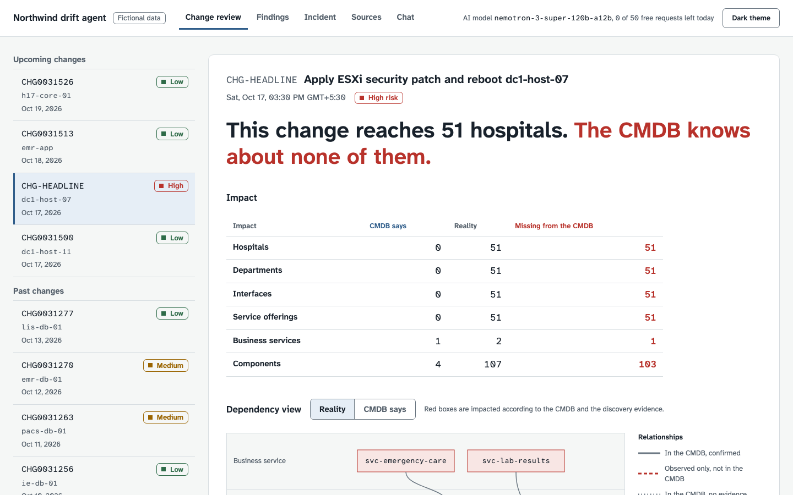
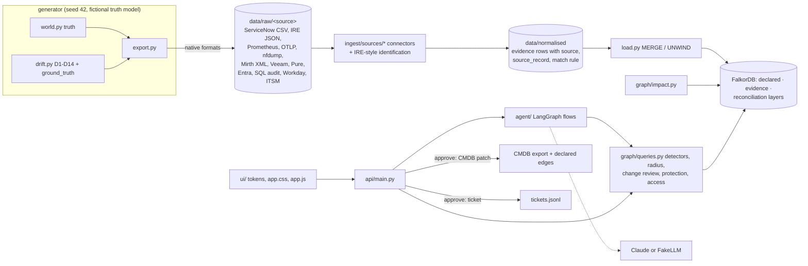
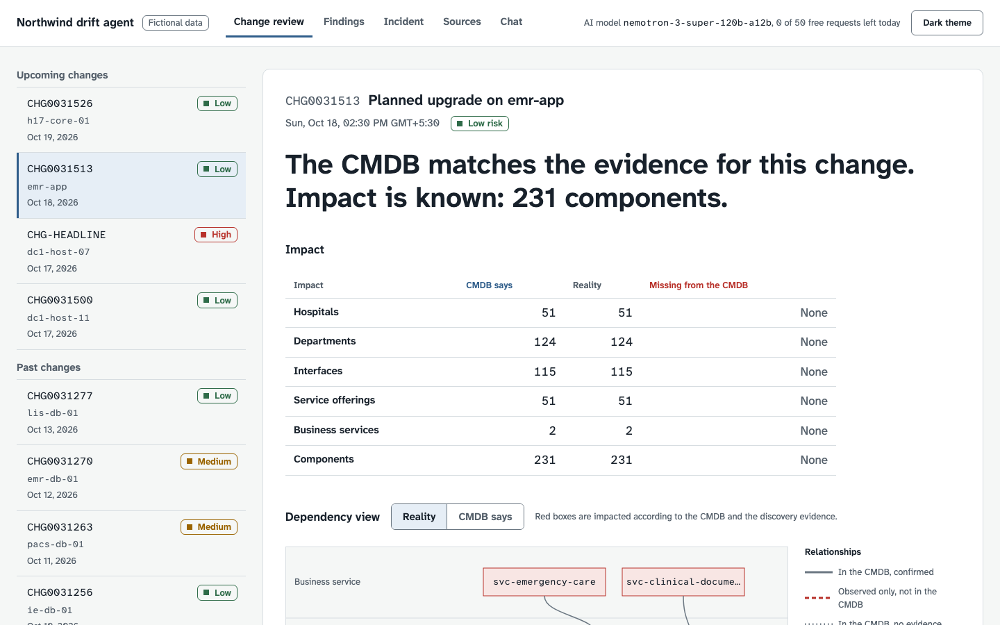
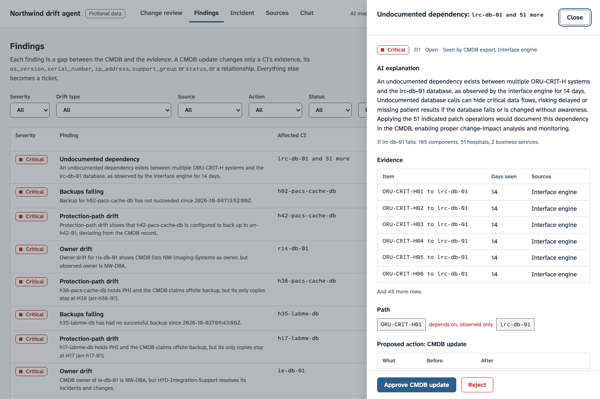

# Northwind drift agent

**What breaks when this fails, and who do I call?** A CMDB says one thing and production does another.
This project keeps both in one FalkorDB graph: what the CMDB declares, and what traffic, scans, backups and
logins prove. It finds the drift, computes the real blast radius of a change, and explains it with paths.

> **All data is fictional.** "Northwind Health" is an invented health system, sized like a large US health
> system (51 hospitals, 1,000 clinics, 800 non-acute sites, 7 western states, two data centres, two cloud
> regions, a Hyderabad capability centre). No real organisation's systems, people, addresses or incidents
> are represented. Users are pseudonymous IDs; there are no names, emails or patients. City names are real
> places used only as locations.



**The demo moment.** `CHG-HEADLINE` patches and reboots host `dc1-host-07`. The CMDB says that touches 4
components and one business service, LIS reporting, so the change is low risk. The graph shows otherwise.
The lab results cache `lrc-db-01` runs on that host, and every hospital's critical-lab-results route to the
Emergency department stages messages in it. The real radius is 51 routes, 51 hospitals' Emergency departments
and the Emergency care business service, so the risk is **HIGH**. The CMDB also names the wrong team: the
database moved to the Hyderabad integration team.

## Live demo

**https://northwind-drift-agent.vercel.app** (Vercel Hobby, function in `bom1` Mumbai; FalkorDB Cloud free tier in
AWS ap-south-1, the same region).

- It runs the demo subset (all 51 hospitals, the full drift catalogue, 6,482 components) in public mode
  (`DEPLOY_MODE=public`): nothing is generated on startup and nothing is written to disk.
- AI text is **cached only**: answers recorded with free models are bundled read-only (`deploy/llm_cache/`) and
  shown as "Cached AI explanation". Anything not in the bundle shows the rule-based explanation with "No cached AI
  explanation for this request". No model is called, so the demo costs nothing and cannot run out of requests.
- Approvals work: a CMDB update changes the graph (the demo's CMDB), and tickets, notifications, the audit trail and
  an undo log are stored as `:Record` nodes in FalkorDB. **Reset demo** (header button, `POST /reset`) undoes every
  approval from the undo log, clears the records, rebuilds the impact layer and re-runs triage. A daily Vercel
  cron (`/cron/reset`, 21:00 UTC, Hobby allows once a day) does the same, which also keeps the free instance from
  being stopped for inactivity.
- `GET /api/health` reports database connectivity and latency.

## Run

```bash
docker compose up --build     # FalkorDB + seed (generate raw exports, run connectors, load; ~25 s) + API/UI
open http://localhost:8000    # UI; FalkorDB browser on http://localhost:3000
```

Everything works without an API key: detection, blast radius, change review, findings, approvals and the UI.
For the live agent (LLM explanations, incident investigation, judgement, chat), copy `.env.example` to `.env`
and set `OPENROUTER_API_KEY` for free models (see [Using free models](#using-free-models)), or
`LLM_PROVIDER=anthropic` with `ANTHROPIC_API_KEY` (model `NORTHWIND_MODEL`, default `claude-sonnet-5-5`).

Development:

```bash
uv venv --python 3.11 && uv sync --frozen
docker compose up -d falkordb
uv run python -m ingest.generate --seed 42 --out data/      # raw exports + connectors, ~15 s, ~390 MB
uv run python -m ingest.connect --data data/                 # re-run the connectors alone
uv run python -m ingest.load --data data/ --graph northwind --fresh
uv run python -m pytest -q                                   # 97 tests; agent tests use a scripted fake LLM
uv run uvicorn api.main:app --port 8000
```

### Deploy your own (Vercel Hobby + FalkorDB Cloud free tier)

1. **FalkorDB Cloud**: sign up (https://www.falkordb.com/try-free/), create a **Free** instance (pick the AWS
   region closest to your Vercel region; this demo uses ap-south-1). In the console, **Deployments → Instances →
   your instance**: the **Connectivity** tab shows the endpoint `host:port`, the **Instance Details** tab shows the
   FalkorDB user and password (**Show**). The free tier has no TLS.
2. **Load the demo subset once, from your machine**: put the four values in `.env` (gitignored) as
   `FALKORDB_HOST`, `FALKORDB_PORT`, `FALKORDB_USERNAME`, `FALKORDB_PASSWORD`, then run
   `uv run python -m deploy.load_cloud`. It tries TLS and plain connections, keeps the one that works, loads
   `data_demo/` fresh, runs triage, and prints memory per step (free tier: 100 MB).
3. **Vercel**: `npm i -g vercel`, then in the repository `vercel link` (creates the project; `.vercel/` is
   gitignored).
4. **Credentials go in Vercel, not in files**: Project → **Settings → Environment Variables** (Production), add
   `DEPLOY_MODE=public`, `FALKORDB_HOST`, `FALKORDB_PORT`, `FALKORDB_USERNAME`, `FALKORDB_PASSWORD`,
   `FALKORDB_TLS=false`, `NORTHWIND_DATA=data_demo` and `CRON_SECRET` (any random string of 16+ characters). Or from
   the CLI: `vercel env add FALKORDB_PASSWORD production` and paste the value at the prompt.
5. `vercel deploy --prod`. `vercel.json` sets the FastAPI preset, region `bom1`, a 60-second function limit, the
   files excluded from the function (full data, tests, docs, generator), and the daily reset cron;
   `.vercelignore` keeps the 390 MB data set out of the upload. The entrypoint is `index.py`.
6. Check `https://<project>.vercel.app/api/health`: `"db": "connected"`.

To refresh the cached AI answers: run the demo flows locally with a free OpenRouter key (`python -m agent.prewarm`),
then `python -m deploy.bundle_cache` and redeploy.

## Architecture



The LLM never writes to the CMDB or to declared edges. It reads through fixed, parameterised Cypher tools and
writes only `:Finding` nodes and mock pages. A CMDB change happens only when a human approves a finding's
proposed patch; everything else becomes a ticket. Approval re-runs the detector and appends to `runtime/audit.jsonl`.

## Where the data comes from

Every input is the export of a real tool's documented format (sources in `RESEARCH_NOTES.md` R9–R18). Each source has a
connector in `ingest/sources/<source>.py` that turns its raw files into normalised evidence; the loader loads only that.

| Source | Real-world tool it stands in for | Raw format generated | Window |
|---|---|---|---|
| `cmdb_export` | ServiceNow CMDB table export | CSV exports of `cmdb_ci`, `cmdb_rel_ci` (parent/child/type as sys_ids), `cmdb_rel_type`, `cmn_location`, `cmn_department`, `sys_user_group`, `change_request` (raw choice codes) | current state |
| `discovery_scanner` | ServiceNow Discovery / BMC Helix Discovery | IRE payload JSON `{"items": [{className, values, lookup}], "relations": [...]}` per scan batch, listening services (`tcp_port`), scan schedule | last scan per subnet |
| `apm_otel` | OpenTelemetry Collector `servicegraph` connector -> Prometheus | Prometheus text scrapes of `traces_service_graph_request_total`, `..._failed_total`, `..._request_server_seconds` histogram (`client`, `server`, `connection_type`, `failed`); OTLP/JSON span sample | 14 days (hourly demo + central, daily elsewhere) |
| `netflow` | IPFIX / NetFlow v9 collector (nfdump) | nfdump 1.7 CSV (`firstSeen, duration, proto, srcAddr, srcPort, dstAddr, dstPort, packets, bytes, flows`) + reverse-DNS/tag enrichment | 14 days |
| `interface_engine` | Mirth Connect / NextGen Connect | channel export XML (TCP Listener, TCP Sender, Database Writer with JDBC URL, DICOM Listener/Sender) + daily ChannelStatistics per connector with SOURCE metadata | 14 days |
| `backup_software` | Veeam Backup & Replication | REST `/api/v1/sessions` JSON (BackupJob, BackupCopyJob, `isStorageSnapshot`, Success/Warning/Failed) | 14 days |
| `storage_telemetry` | Pure Storage FlashArray REST 2.x | `pod-replica-links` (async: lag, recovery_point, status) and `pods` (sync) samples, hourly | 14 days |
| `identity_sso` | Microsoft Entra ID sign-in logs | Graph `signIn` JSON (userPrincipalName = bare pseudonymous ID, appDisplayName, deviceDetail, status.errorCode) | 14 days |
| `db_audit` | SQL Server Audit (`sys.fn_get_audit_file`) | audit CSV (event_time, action_id SL/UP/AL…, server_principal_name, database_name, statement) | 14 days, demo sites + GCC-HYD |
| `hr_feed` | Workday-style worker export | RaaS CSV (Employee_ID, Worker_Status, Active / Terminated / On_Leave flags, dates; no names) | current state |
| `itsm_history` | ServiceNow `incident` / `change_request` history | CSV exports with sys_id references and raw state codes | 90 days |


**HL7 interfaces.** Interfaces are CMDB CIs registered by the integration team in the custom class
`u_cmdb_ci_hl7_interface` (what real ServiceNow customers do; there is no out-of-the-box HL7 class). What the CMDB
lacks is each interface's internal destinations. Those are discovered from the interface engine's channel
configuration and statistics: the `ORU-CRIT-*` channels' Database Writer JDBC URL
(`jdbc:sqlserver://dc1-vm-lrc01:1433;databaseName=lrc`) is how the headline dependency on `lrc-db-01` is found.

## How evidence is calculated

**Identification** (all connectors, `ingest/sources/identify.py`, ServiceNow IRE order): `serial_number`, then `name`
(case-insensitive, aliases included), then `ip_address` (unique IPs only); the server end of network evidence first
tries `ip:port` against the scanner's listening services. The rule used is recorded on every row
(`match_rule` / `client_rule` / `server_rule`, `IDENTIFIES {matched_by}`). Unmatched evidence becomes an
`:UnregisteredEndpoint` (network/sign-in) or a shadow-IT candidate (discovery).

| Source | Calculation |
|---|---|
| `apm_otel` | One edge per (client, server): `count` = sum of counter increases, `errors` from the failed counter, `p95_ms` by linear interpolation inside the histogram bucket holding the 95th percentile, `days_seen` = distinct UTC days with a non-zero increase. The span sample, parsed with the standard rule (CLIENT -> SERVER span in another service, or CLIENT with `db.system` / `server.address`), agrees with the metrics for the sampled hours (test). |
| `netflow` | The server is the endpoint on a well-known or registered service port (104, 443, 636, 1433, 1972, 2575, 5000, …); an ephemeral port (≥ 49152) marks the client. Aggregated per (client CI, server CI, server port): bytes, packets, `days_seen`, first/last seen. Monitoring probes are excluded. |
| `interface_engine` | Each channel = the Interface CI of the same name. Each destination connector = an edge route -> destination (TCP Sender host:port, Database Writer JDBC host:port -> the database listening there, HTTP sender -> API). Statistics give `count` (sent), `errors` (error), `days_seen`; the source connector's SOURCE metadata gives the inbound edge from the sending system. |
| `backup_software` | Per object: `last_success` (latest Success or Warning; snapshot-only never counts), target, and Backup Copy targets (other site, immutable vault); copies also prove repository replication. A Failed job followed by a Success within 48 h is not a finding. |
| `storage_telemetry` | Per pair: mode, `max_lag_s`, last transfer, state; lag above the RPO of what the array stores for more than 1 h continuously is reported in the protection check. |
| `identity_sso` + `db_audit` | Successful sign-ins -> user -> application access; audit SELECT / DML / DDL-admin -> read / write / admin on the database (admin keeps every timestamp). Compared with MEMBER_OF -> HAS_ROLE -> GRANTS and approved change windows; employment status from `hr_feed`. |
| `itsm_history` | Observed owner = the assignment group with the most resolved incidents plus implemented changes in 90 days; ties are not reported. |

**Thresholds** (`ingest/config.py`): undocumented / unregistered traffic on ≥ 3 distinct days; backups failing = no
success in 7 days (cutoff 2026-10-07T23:59:59Z); transient failure window 48 h; ownership window 90 days; RPO breach
> 1 h; ephemeral ports ≥ 49152; snapshot end 2026-10-14T23:59:59Z (replay data, never "now").

Comparison change `CHG0031513` (planned upgrade of `emr-app`) touches far more, but the CMDB already records it all, so it is LOW risk: the risk is the gap, not the size.



A finding shows its evidence sources and whether approval patches the CMDB or raises a ticket:



## What may be written back to the CMDB

A finding may propose a **CMDB patch** only when it concerns a CI's existence, one of its CMDB attributes
(`os_version`, `serial_number`, `ip_address`, `support_group`, `status`) or a CMDB relationship. Metrics, events, job
runs, logins and lag values never go into the CMDB (`agent/approval.validate` rejects anything else).

| Finding | Action on approval |
|---|---|
| D1 undocumented dependency, D2 stale relationship, D4 retired CI still linked, D5 owner drift, D6 shadow IT (register CI), D7 ghost (retire after confirmation), D8 attribute drift, D14 unregistered app (register if approved, otherwise security ticket) | CMDB patch to the CMDB export + declared graph edges, recorded as a closed `change_request` |
| D9 protection gap, D10 backups failing | `incident` to NW-Backup-Storage |
| D11 data residency | `sn_si_incident` + compliance notification |
| D12 access drift | `sn_si_incident` |

Tickets are ServiceNow-shaped JSON (`table`, `short_description`, `cmdb_ci`, `assignment_group`, `priority`,
`category`, `description` with evidence and sources) appended to `runtime/tickets.jsonl`; there is no real ticketing
integration.

## Data model

The graph keeps three layers apart (every node and edge has a `layer` property):

| Layer | Contents | Graph |
|---|---|---|
| **CMDB (declared)** | the `cmdb_export` connector's tables and the IAM export | `:Component` + class label, `:Site`, `:Department`, `:SupportGroup`, `:Change`, `:User`, `:Group`, `:Role`; `CONTAINS`, `DEPENDS_ON {failover}`, `RUNS_ON`, `STORES_ON`, `REPLICATES_TO`, `BACKED_UP_BY`, `CONNECTS_THROUGH`, `LOCATED_AT`, `IN_DEPARTMENT`, `MANAGED_BY`, `MEMBER_OF`, `HAS_ROLE`, `GRANTS`, `TARGETS` |
| **Evidence (discovered / observed)** | normalised connector output, each item with `source`, `source_record`, first/last seen and measurements | `:Discovered`, `:UnregisteredEndpoint`; `OBSERVED_CALLS {source}`, `OBSERVED_NETFLOW {port}`, `OBSERVED_REPLICATES_TO`, `OBSERVED_BACKUP_TO {job_type}`, `OBSERVED_ACCESS {action}`, `OBSERVED_OWNER` |
| **Reconciliation** | identification, analysis and findings | `IDENTIFIES {matched_by}`, `IMPACTS_*` / `AFFECTS_*`, `:Finding`, `ABOUT` |

Classes follow ServiceNow and CSDM: Business Service (`cmdb_ci_service_business`), Service Offering
(`service_offering`, the 51 per-hospital ED critical-results services, contained by `svc-emergency-care`),
Application, Interface (HL7), Database, Virtual Machine, Server, Storage Array, Backup Target, Network Device,
Medical Device, Endpoint / Endpoint Group. Offerings and business services are counted separately everywhere.
Relationship names: Contains, Depends on, Runs on, Stored on, Replicates to, Backed up by, Connects to.

The full data set has about 49k nodes and 142k edges.

**Why declared and evidence stay separate.** The gap between them is the product. Keeping both on the same nodes
makes "in the CMDB but never seen" and "seen but never declared" a single pattern match each.

**Impact layer.** `graph/impact.py` materialises one documented rule set as derived edges, built in Cypher
(`IMPACTS_DECLARED` from declared edges only, `IMPACTS_REAL` from declared structure plus evidence, terminal
`AFFECTS_*` to a route's data consumer and the departments it serves). Direction is always "if a fails, b is
impacted": runs on, stored on, depends on and observed calls propagate; a route that pushes data depends on its
source; a business service or offering is impacted when anything it contains is. Health checks, failover links and
calls into telemetry sinks never carry impact.

**The UI** (`ui/`, designed to `UI_SPEC.md`; plan and self-critique notes in `docs/ui-plan.md`) answers "is this
change safe, and if not, what is the CMDB missing and who do I warn?". Every screen uses the same two colours for
the two records of the hospital: blue for what the CMDB declares, red for evidence that contradicts it. The change
review opens with a verdict sentence computed from the counts ("This change reaches 51 hospitals. The CMDB knows
about none of them."), then a CMDB-says / Reality / Missing table, the dependency view, hidden dependencies with
their source, who to warn and the AI (or rule-based) explanation. The dependency view draws tiers from business
service down to storage array with the tier names in a left gutter and arrows in CMDB direction; more than five
siblings of one class sharing the same neighbours collapse into one group box ("51 interfaces (ORU-CRIT-H*)"), so the
headline is an eight-box chain. Solid = in the CMDB and confirmed, dashed red = observed only (always labelled),
dotted = in the CMDB with no evidence, dash-dot blue = failover; impact is a red fill driven by the Reality / CMDB
says toggle. Every box and line is keyboard-focusable with a tooltip (source, counts, days seen, first and last
seen). Findings are a filterable table with a drawer (evidence, path, before/after diff or ticket preview,
"Approve CMDB update" / "Create ticket"). On phones the graph becomes the impact path as a list. Screenshots of
every tab, light and dark, 1440 and 390 px: `docs/ui-after/`; the old UI: `docs/ui-before/`.

## Drift catalogue

These cases are injected on purpose and recorded in `data/ground_truth.json`.

| Type | What it is | How many |
|---|---|---|
| D1 | Undocumented dependency | 8, including the headline: 51 routes → `lrc-db-01` |
| D2 | Stale relationship | 6 |
| D3 | Failover trap (must **not** be flagged) | 4 |
| D4 | Retired CI still linked | 3 |
| D5 | Owner drift | 6 |
| D6 | Shadow IT | 10 |
| D7 | Ghost CI | 5 |
| D8 | Attribute drift | 8 |
| D9 | Offsite protection is only same-site snapshots | 4 |
| D10 | Backups failing for more than 7 days | 3 |
| D11 | PHI replicated into cloud-central-india | 1 |
| D12 | Access with no grant path, disabled user, or admin outside a change window | 4 |
| D13 | Naming mismatch (must resolve to the same CI, not be flagged) | 5 |
| D14 | Unregistered SMART on FHIR app used by H17 cardiology | 1 |

The Cypher detectors return exactly the ground-truth keys, on both the full data and the demo subset. A
pure-Python oracle (`tests/oracle.py`) checks the same rules independently.

## Cypher queries (`graph/queries.py`)

| Query | One line |
|---|---|
| `DETECTORS["D1"]` | Observed calls/netflow between two CIs on ≥ 3 distinct days with no declared `DEPENDS_ON` either way |
| `DETECTORS["D2"]` | Declared `DEPENDS_ON`/`REPLICATES_TO`, not failover, neither end retired, nothing observed in 14 days |
| `DETECTORS["D4"]` | Retired CI that still has CMDB relationships |
| `DETECTORS["D5"]` | Dominant `OBSERVED_OWNER` team differs from `MANAGED_BY` |
| `DETECTORS["D6"]` | `:Discovered` with no `IDENTIFIES` edge |
| `DETECTORS["D7"]` | Operational, discoverable CI in a scanned subnet, never identified, no traffic |
| `DETECTORS["D8"]` | Identified CI whose `os_version`, `serial_number` or `ip_address` differs from the scan |
| `DETECTORS["D9"]` | PHI CI claiming offsite backup whose `STORES_ON`/backup/replication paths never leave its site |
| `DETECTORS["D10"]` | CI with a backup policy and no successful backup in the last 7 days |
| `DETECTORS["D11"]` | PHI data replicated (or sent) into cloud-central-india |
| `DETECTORS["D12"]` | `OBSERVED_ACCESS` without a `MEMBER_OF → HAS_ROLE → GRANTS` path, by a disabled user, or admin outside approved `Change` windows |
| `DETECTORS["D14"]` | `:UnregisteredEndpoint` carrying traffic on ≥ 3 days |
| `ALIASES` | D13: names resolved to the same CI by serial or IP (stored in `Component.aliases`) |
| `RADIUS` | `algo.bfs` over `IMPACTS_DECLARED` or `IMPACTS_REAL`, then terminal consumers, departments, hospitals, business services |
| `PATH` / `LAST_HOP` | `shortestPath` over one impact layer, for the ordered node/rule path the UI highlights |
| `change_review` | Targets' declared vs real radius, the undocumented edges inside the real radius, and the risk (high if a high-safety service appears only in reality) |
| `UNDOCUMENTED_IN` | Observed edges inside a node set with no declared dependency (the hidden edges of a change) |
| `PROTECTION` | PHI components with no copy at another site, no copy in the immutable vault, or no recent success |
| `WHO_TO_PAGE` | Declared vs observed owner per component, flagged where they differ |
| `CRITICAL` | `algo.betweenness({nodeLabels:['Component'], relationshipTypes:['OBSERVED_CALLS'], samplingSize:5000, samplingSeed:42})`, top 10 |
| `SHARED` | Components that every given route needs (the common cause behind a multi-site symptom) |
| `RECENT_CHANGES` | Changes targeting a set of components |
| `D14_PATH` | Group → users → unregistered app → FHIR API → database |
| `NEIGHBOURHOOD` / `COMPONENT` / `SEARCH` / `EDGE_LAYERS` | Bounded lookups for the agent and UI; `EDGE_LAYERS` colours edges as observed-only, declared-only, failover or structural |

Every agent tool query has a LIMIT and a 5-second timeout; a timeout returns "query timed out" instead of
raising. FalkorDB runs with a 10-second default query timeout. On the full graph the heaviest query, D12, takes
about 0.55 s.

## Why a graph

- **Multi-hop paths across layers.** Host → VM → database → 51 routes → 51 Emergency departments → Emergency
  care is one traversal, mixing declared structure and observed traffic.
- **Two edge layers on the same nodes.** "Declared but never observed" and "observed but never declared" are
  each a single pattern. A blast radius computed on declared edges only can be compared with one on observed
  edges, on the same nodes.
- **Built-in algorithms.** BFS for the radius, shortest paths for the explanation, betweenness for single points
  of failure. A seeded run gives the same top 10 every time.

## Agent (`agent/`)

These are LangGraph flows over the Cypher tools:

1. **Triage** runs every detector and groups related rows (the 51 headline rows become one finding). It
   scores each finding by patient-safety impact, real-radius size and PHI exposure. It proposes a CMDB JSON
   patch, stores the result as `(:Finding)-[:ABOUT]->(:Component)`, and returns the top 10.
2. **Change review** explains declared vs real radius, names the hidden edges, and says who to warn, preferring
   the observed owner.
3. **Incident** takes a symptom ("ED critical results delayed at H03, H17 and H22"). It finds what the
   affected routes share, then the changes on those components, then the path to the likely cause.
4. **Ambiguity** judges each D13 alias and the D14 app as "same CI, add alias", "real undocumented dependency"
   or "possible security risk, escalate". The reasons are stored on the finding.
5. **Chat** answers only through tools, cites paths, and says so when nothing was found.

All tests use a deterministic scripted LLM, so no key is needed. Live providers: OpenRouter free models
(OpenAI-compatible API, `agent/llm.py`) or Claude through the official `anthropic` SDK with refusal fallback.
Each job has a request cap: triage 1 (the top-10 explanations are one batched call), change review 1,
incident at most 6, chat at most 4 per message. The model is told its budget, and the last allowed call has
tools disabled and gets the gathered evidence as text, so it must answer; if it cannot, a rule-based summary of
the tool results (shared dependency, changes, path, owners) is shown instead.

**Grounding.** Every job passes its computed facts (counts, names, risk, tool results) as structured input and
the prompt says to use only those values. Every number and CI name in the reply is then checked against the
facts; on any mismatch the prose is discarded, the rule-based explanation is shown with a notice, and the
mismatch is logged.

## Using free models

1. Create an account at [openrouter.ai](https://openrouter.ai), then a key under **Settings → API Keys**
   (`sk-or-v1-...`). No credit card is needed for `:free` models.
2. Put it in `.env`: `LLM_PROVIDER=openrouter` and `OPENROUTER_API_KEY=sk-or-v1-...`. The API, the Docker stack
   (`env_file`) and `python -m agent.prewarm` read it; for a local `uvicorn`, export it first
   (`set -a; . ./.env; set +a`).
3. Optional: `NORTHWIND_MODELS`, a comma-separated preference list.

At startup the API calls OpenRouter's models API and keeps only models whose ID ends in `:free`, whose prompt and
completion prices are zero and whose `supported_parameters` include `tools`, and logs which are available. If
none of the listed models qualify it picks the free tool-capable model with the largest context. The kept list
is sent as OpenRouter's `models` fallback array, so a rate-limited or failing model falls through to the next.


**Limits.** Free models allow 20 requests per minute and 50 per day without purchased credits (1,000 per day with
at least 10 credits bought). Failed requests count. The agent therefore keeps a persistent daily counter
(`runtime/llm_budget.json`, `NORTHWIND_DAILY_REQUESTS`) and a one-minute window, never sends a request past
either, retries at most once after a 429 (waiting `Retry-After`, at most 20 s), and shows the remaining requests
in the UI header, read from OpenRouter's key-info endpoint (`GET /api/v1/key`, `free_model_daily_requests`).

**Saving requests.** Every response is cached on disk (`runtime/llm_cache/`, keyed by model list plus a hash of
the prompt, messages and tools), so repeating a demo costs zero requests. Fill the cache once before a demo:

```bash
python -m agent.prewarm                          # local
docker compose exec api python -m agent.prewarm  # stack
```

It runs triage, both demo change reviews, the demo incident and the demo chat question, and prints the requests
used.

**When the budget runs out** or every model fails, the agent shows the rule-based explanation with the notice
"AI explanation unavailable (free-tier limit), showing rule-based explanation" instead of an error. Detection,
blast radius and the change review facts and risk never depend on the LLM.

**Privacy.** OpenRouter itself does not log prompts by default, but the providers behind free endpoints may
retain prompts or train on them; each endpoint has its own data policy, and OpenRouter's privacy settings have a
separate switch for free endpoints that may train on inputs. That is acceptable here because every prompt holds
only the synthetic Northwind Health data. Do not send real CMDB or patient data to free models.

## API

| Method | Endpoint | Purpose |
|---|---|---|
| GET | `/health` | Service and graph status |
| GET | `/api/health` | Database connectivity and latency (503 when unreachable) |
| POST | `/reset` | Public mode: undo every approval and restore the demo |
| GET | `/cron/reset` | Same, for the daily Vercel cron (needs `Authorization: Bearer $CRON_SECRET`) |
| GET | `/llm` | LLM provider, models and remaining free requests today |
| POST | `/scan` | Run triage |
| GET | `/findings`, `/findings/{id}` | List findings, or one finding with its before/after diff |
| POST | `/findings/{id}/approve`, `/findings/{id}/reject` | Approve or reject a proposed patch |
| GET | `/changes` | List changes with their rule-based risk |
| POST | `/changes/{id}/review` | Change review (facts, hidden dependencies, dependency view, explanation) |
| GET | `/components/{name}/review` | What breaks if one CI fails (same shape, no LLM) |
| POST | `/incident` | Incident investigation |
| GET | `/radius?component=&layer=declared\|real` | Blast radius |
| GET | `/subgraph?component=&depth<=2` | Bounded neighbourhood for the UI |
| GET | `/critical` | Critical nodes |
| GET | `/hospitals?component=` | Hospital map, flagged by radius |
| GET | `/notifications` | Mock pages |
| POST | `/chat` | Chat |

## Data disclosure

This is synthetic data from `ingest/generate.py` with seed 42, deterministic and byte-identical across runs.
It is sized on the public footprint of a large US health system. All systems, interfaces, incidents, users
and changes are fictional. There is no personal or patient data.

Real vendor product names appear only as device models. Addresses are RFC 1918 private ranges, plus RFC 5737
documentation addresses for SaaS. Realism choices (device counts, HL7 types, DICOM, backup tiers, ServiceNow
classes) are sourced in `RESEARCH_NOTES.md`.

## AI-usage disclosure

The code, data generator, tests and documentation were written with an AI coding assistant working from the
author's specifications (`DATA_SPEC.md`, `RUN_PROMPT.md`, `AGENT_SPEC.md`). Independent AI reviews checked
the result against those specifications. The author designed the scenario, the drift catalogue and the
specifications, and reviews the output.

Every decision is logged in `DECISIONS.md`. The running agent uses OpenRouter free models or Claude through the
Anthropic API when a key is configured.

## Known limits

- The observed layer is synthetic and aggregated (hourly or daily flows). A live deployment would ingest
  OpenTelemetry, netflow and backup-tool exports.
- Impact semantics are a documented rule set, not ground truth. A data consumer, such as the EMR receiving
  results, is affected but does not propagate impact further.
- Sampling and quiet periods matter. A dependency seen on fewer than 3 days is not flagged, and failover paths
  are excluded from staleness on purpose.
- Fixes need human approval, because the observed layer can be wrong (aliases, transient traffic). Approval
  re-runs the detector to confirm the fix.
- Re-seeding resets the graph and CSVs, so approvals do not survive `docker compose up`.
- There is no auth and no multi-user support.

## Prior art

ServiceNow Service Graph Connectors bring discovered and observed data into the CMDB. Now Assist for CMDB adds
generative assistance on top.

This project differs in three ways:
- It is open source and runs on a graph database.
- Declared and observed stay **separate layers** instead of being reconciled into one record, so the
  disagreement itself is queryable.
- Every finding and radius comes with the **exact path**, and CMDB writes happen only through approval.

## Repository

`ingest/` holds the truth model, raw exporters (`export.py`), source modules and connectors (`sources/`), the connector runner (`connect.py`) and the loader. `graph/` holds the impact rules and queries. `agent/` holds the LLM
interface, tools, findings, approval and flows. `api/` is the FastAPI service. `ui/` is the UI: `tokens.css` (every colour, size and spacing), `app.css`, `app.js` and `index.html`, no build step.
`tests/` has 79 tests, the oracle, sanity queries and the VERIFY generator.

`data_demo/` is a committed gzip subset: all 51 hospitals, both data centres, both cloud regions and GCC-HYD.

Results and the run log are in `REPORT.md`, `VERIFY.md` and `PROGRESS.md`. Decisions are in `DECISIONS.md`.
