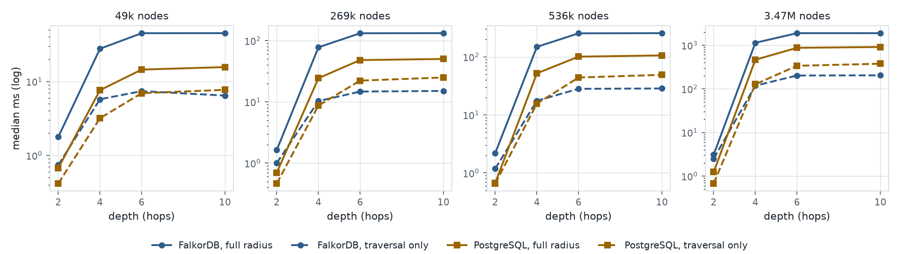
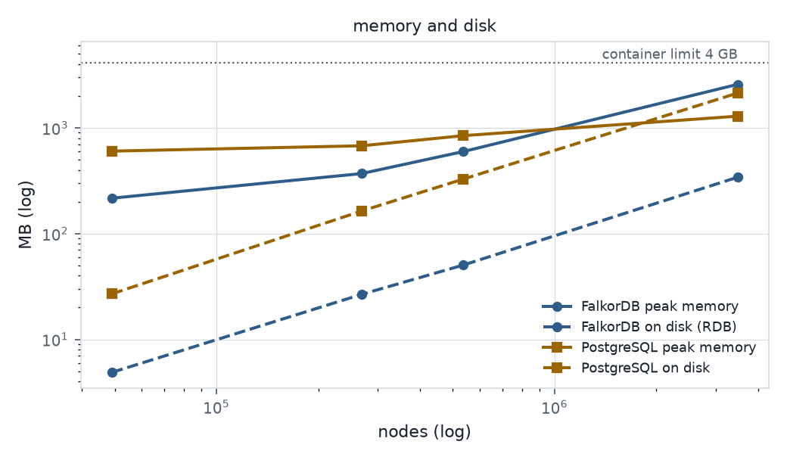

# Does the graph approach hold up as the hospital system grows?

Measured on one laptop, 16 October 2026: FalkorDB against a tuned PostgreSQL, on the same data, the same
questions and the same container limits. Every number below comes from `bench/results/` (raw JSON lines with
the full context of each run); nothing was dropped. Where PostgreSQL is faster, the tables say so.

**Short answer.** The traversal itself scales well in FalkorDB: for the largest radius (105,713 components at
3.47M nodes) one BFS call takes 203 ms against 375 ms for PostgreSQL's recursive query, and FalkorDB's tail
latency (p95, p99) under 50 and 100 concurrent clients is 1.4-4x lower. But on the full blast-radius
question as the app asks it (traversal plus consumers, departments and hospitals, decoded by a Python client),
PostgreSQL is 2-3x faster at every size, sustains more queries per second, loads 20x faster and needs less
memory. The graph's advantage here is in modelling and in the shape of the questions, not in raw speed at
these sizes.

## Setup

| | |
|---|---|
| Hardware | Apple M4, 10 cores, 32 GB RAM, SSD (147 GB free); macOS 27.0.1 |
| Docker | Docker Desktop 29.1.3, VM with 9.7 GB memory and 10 CPUs |
| Limits (both systems) | 4 GB memory, no swap, 4 CPUs per container |
| FalkorDB | `falkordb/falkordb:v4.22.0` (the project's version), `THREAD_COUNT 4`, no query timeout, snapshots off during the run |
| PostgreSQL | `postgres:18.6`; `shared_buffers=1GB`, `effective_cache_size=3GB`, `work_mem=32MB`, `maintenance_work_mem=512MB`, `max_connections=250`, `random_page_cost=1.1`, `effective_io_concurrency=200`, `jit=off`, `wal_level=minimal`, `synchronous_commit=off` |
| PostgreSQL schema | `node(id, name, kind, label, site, type, patient_safety_impact, …)`, `edge(src, dst, type)`, loaded with `COPY`; indexes on `node(id)` (unique), `node(name)`, `edge(src)`, `edge(dst)`, `edge(src, type)`, `edge(dst, type)`; `VACUUM ANALYZE` after load |
| Client | Python 3.11 on the same laptop (`falkordb` 1.7.1, `psycopg` 3.3.6), prepared statements for PostgreSQL, parameterised queries for FalkorDB; 3 warm-up runs, then 20 timed runs |

### Data sizes

The world grows like a real multi-region health system, never by padding: each additional region copies every
hospital, clinic and non-acute site with everything that belongs to them (site CIs, departments, the
per-hospital interfaces and service offerings, users, groups, discovery records) and shares the enterprise data
centres and central systems; from 500k nodes each extra region also has a small regional data centre. Above the
base size, endpoint groups are replaced by their individual endpoints, as a full CMDB holds them. Same
relationship types, same impact rules (`graph/impact.py`), seed 42.

| Size | Nodes | Edges | Impact edges | Regions | Hospitals | Generated in |
|---|---|---|---|---|---|---|
| 50k (today's world) | 49,063 | 131,784 | 10,370 | 1 | 51 | 0.2 s |
| 250k (pilot) | 268,542 | 883,794 | 29,772 | 3 | 153 | 1.1 s |
| 500k | 535,761 | 1,764,031 | 58,995 | 6 | 306 | 2.1 s |
| 3.5M | 3,474,840 | 11,444,350 | 379,920 | 39 | 1,989 | 11.5 s |

**Why not 5M.** Two measured points (370 MB at 268k nodes, 927 MB at 981k) fit 160 MB + 0.78 KB per node, so
5M nodes would peak at about 4.0 GB in FalkorDB, over the 4 GB limit. Docker's 9.7 GB VM holds both containers,
so the limit could not be raised for both. 3.5M is the largest whole-region size under 75% of the limit
(measured peak: 2.58 GB). DECISIONS #89.

## The two query shapes, in plain words

- **FalkorDB** answers "what breaks if X fails" with one call, `algo.bfs(X, depth, 'IMPACTS_REAL')`, a
  breadth-first search inside the database that follows each node's adjacency directly. The full question then
  looks up, for every node reached, its terminal consumers, departments and sites (the project's `RADIUS` query).
- **PostgreSQL** answers it with a recursive query: start from X, and in each round join the current frontier
  with the edge table through the `(src, type)` index, stopping at the depth cap. A depth-10 radius is up to ten
  rounds of index lookups; `UNION` removes duplicate (node, depth) rows, so a node reached at two depths is
  expanded twice. The same lookups for consumers, departments and hospitals follow. `EXPLAIN ANALYZE` (kept in
  `results/<size>/depth.jsonl`) shows index scans on `edge_src_type_idx` for every round and on `node_name_idx`
  for the start.
- Both systems traverse **the same edges**: the impact edges FalkorDB materialised were exported and copied into
  PostgreSQL next to every generated edge.
- Two query kinds are timed: **full radius** (what the app asks) and **traversal only** (the set of components
  reached).

## Correctness gate

For every size, start point, depth and query kind (24 cases per size), the impacted sets, and for the full
radius also the consumer, department and hospital sets, were identical in both systems. Gate passed at all four
sizes; no timing is reported for any case that differed (none did). Change review results matched too.

## Results

### Query time vs depth



Start point: the busiest storage array (`arr-pri-a-03`, the largest radius). Depth 6 and 10 give the same
answer: the impact graph is at most six hops deep.

### Query time vs size (depth 10)


Median milliseconds at depth 10, all three start points (FalkorDB end to end, and its server-side time for one
run in brackets):

| Nodes | Start | Reached | FalkorDB full radius | PostgreSQL full radius | FalkorDB traversal | PostgreSQL traversal |
|---|---|---|---|---|---|---|
| 49k | `dc1-host-07` | 107 | 4.3 (4.0) | **1.6** | 1.4 | **0.9** |
| 49k | `emr-app` | 231 | 7.6 (7.8) | **2.3** | 1.7 | **1.3** |
| 49k | `arr-pri-a-03` | 2,771 | 45.1 (44.0) | **15.7** | **6.4** | 7.7 |
| 269k | `dc1-host-07` | 311 | 8.5 (9.9) | **2.6** | 2.3 | **1.8** |
| 269k | `emr-app` | 663 | 13.7 (18.4) | **4.1** | 3.1 | **2.5** |
| 269k | `arr-pri-a-03` | 8,189 | 132 (87) | **50** | **15** | 25 |
| 536k | `dc1-host-07` | 617 | 13.3 (16.2) | **4.2** | 3.7 | **2.4** |
| 536k | `emr-app` | 1,311 | 23.7 (27.9) | **8.2** | 5.7 | **3.3** |
| 536k | `arr-pri-a-03` | 16,316 | 255 (122) | **106** | **28** | 49 |
| 3.47M | `dc1-host-07` | 3,983 | 80 (71) | **30** | 9.7 | **9.5** |
| 3.47M | `emr-app` | 8,439 | 171 (108) | **67** | **16** | 19 |
| 3.47M | `arr-pri-a-03` | 105,713 | 1,882 (756) | **908** | **203** | 375 |

### Concurrency


Random start points (seed 42) among components with impact edges, full radius at depth 10, 60 s per level:

| Nodes | Clients | FalkorDB q/s | PostgreSQL q/s | FalkorDB p50 / p95 / p99 ms | PostgreSQL p50 / p95 / p99 ms |
|---|---|---|---|---|---|
| 49k | 10 | 1,499 | **1,625** | 2.5 / **18.7** / **69** | **0.7** / 54 / 92 |
| 49k | 100 | 995 | **1,457** | 95 / **161** / **239** | **14** / 271 / 818 |
| 536k | 10 | **676** | 661 | 2.9 / **46** / **60** | **0.7** / 79 / 92 |
| 536k | 100 | 439 | **630** | 213 / **350** / **470** | **15** / 709 / 1,509 |
| 3.47M | 10 | 136 | **142** | 16 / **289** / **339** | **1.4** / 385 / 405 |
| 3.47M | 50 | 116 | **143** | 392 / **834** / **1,064** | **11** / 2,287 / 3,329 |
| 3.47M | 100 | 87 | **142** | 1,174 / **1,725** / **1,944** | **21** / 4,401 / 7,895 |

No errors at any level. PostgreSQL answers the many small radii very fast (low p50) and keeps the higher
throughput; the big radii queue behind them, which gives it the long tail. FalkorDB's latencies are more even:
p95 and p99 are 1.4-4x lower at 50 and 100 clients, but its median rises with load.

### Change review end to end (CHG-HEADLINE)

Declared radius, real radius and the difference for `dc1-host-07`: FalkorDB 7.3 / 8.8 / 13.9 / 82 ms, PostgreSQL
**1.3 / 2.1 / 3.8 / 31 ms** at 49k / 269k / 536k / 3.47M nodes. Both find the same thing at every size: the CMDB
declares 4 impacted components; reality reaches 107, 311, 617 and 3,983 (51, 153, 306 and 1,989 hospitals).

### Memory, disk and load time



| Nodes | FalkorDB load | PostgreSQL load | FalkorDB peak memory (graph) | PostgreSQL peak memory | FalkorDB on disk | PostgreSQL on disk |
|---|---|---|---|---|---|---|
| 49k | 4.6 s | **0.4 s** | 216 MB (21 MB) | 603 MB | **5 MB** | 27 MB |
| 269k | 34 s | **1.5 s** | 370 MB (127 MB) | 677 MB | **27 MB** | 164 MB |
| 536k | 70 s | **2.9 s** | 596 MB (252 MB) | 844 MB | **50 MB** | 327 MB |
| 3.47M | 482 s | **23 s** | 2,579 MB (1,623 MB) | **1,290 MB** | **342 MB** | 2,133 MB |

FalkorDB keeps the whole graph in memory, so its memory grows with the data; its on-disk snapshot is compact.
PostgreSQL's memory is bounded by its settings (shared buffers plus the page cache Docker counts against the
container, which rises with 100 connections), and its data lives on disk. Load times: FalkorDB is loaded with
batched Cypher `CREATE`s (5,000 rows per batch, edges matched by index) plus the impact-layer build (13 s at
3.47M); PostgreSQL uses `COPY` and builds its indexes afterwards. A bulk loader would narrow the FalkorDB load
time; it was not used.

## Findings

1. **Traversal alone: FalkorDB wins once the radius is large.** From a few thousand components reached,
   one BFS call beats the recursive query, and the gap widens with size (1.2x at 2.8k reached, 1.8x at 106k).
   For small radii (hundreds of components) PostgreSQL's index lookups are as fast or faster.
2. **The full question: PostgreSQL wins end to end at every size (2-3x).** Two reasons, both measured: the
   decoration after the BFS (consumers, departments and hospitals for every node reached) is relatively slower
   in FalkorDB's Cypher than as set-based SQL joins, and the Python client spends a large share decoding
   FalkorDB's nested result (at 3.47M: 756 ms in the database, 1,882 ms end to end). At the largest size
   FalkorDB's server-side time is below PostgreSQL's end-to-end time.
3. **Under concurrency, FalkorDB has the steadier tail, PostgreSQL the higher throughput.**
4. **Memory is FalkorDB's limit on a laptop.** 3.47M nodes need 2.6 GB of RAM in FalkorDB; 5M did not fit
   the 4 GB container. PostgreSQL ran in about half the memory, but needed six times the disk.
5. **The first pilot found a real bug in the project's radius query** (two aggregations grouped by the whole
   impacted list, 2.97 s for an 8k-node radius). Rewriting it with one final aggregation made it 20x faster.
   The first pilot's numbers are kept in `results/archive/`.

## What this benchmark does not cover

- Write-heavy workloads (CMDB updates, evidence ingestion while querying), and the cost of keeping the
  materialised impact layer current.
- Distributed or replicated setups; both systems ran as single instances on one laptop, inside one Docker VM,
  with the Python client on the same machine competing for CPU.
- Cold caches: every timing is after warm-up.
- Other clients: a compiled or async client would cut FalkorDB's decoding overhead; PostgreSQL's array results
  are cheap to decode in any client.
- Other query shapes where graphs usually differ more: variable patterns, shortest paths between arbitrary
  pairs, multi-label pattern matching. Only blast radius was measured.
- FalkorDB holds only the properties the impact rules and the radius query read (the scale loader is leaner
  than the project's loader); PostgreSQL holds the same columns.
- Sizes above 3.47M nodes.

## How to reproduce

```bash
uv sync --group bench
python -m bench.run --sizes 250000                 # the pilot (~10 min)
./bench/start.sh 50000,500000,3500000              # the full run in the background (~45 min here)
cat bench/STATUS.json                              # progress; bench/DONE or bench/FAILED at the end
python -m bench.verify                             # every step present, gate passed, no errors
python -m bench.analyse                            # tables -> bench/results/SUMMARY.md
python -m bench.charts                             # charts -> bench/charts/, site bundle -> ui/scale/
```

The runner is resumable: each (size, system, benchmark) step writes its result file when done and is skipped
when it exists. All tables in this file are in `bench/results/SUMMARY.md` (generated) as well.
