*Built for Graph Hacks 2026 by WeMakeDevs and FalkorDB.*
**Demo video:** https://youtu.be/FjRZv8ZxBCE · **Try it live:** https://change-guardian.vercel.app · **Code:** https://github.com/sudarshan032/northwind-drift-agent

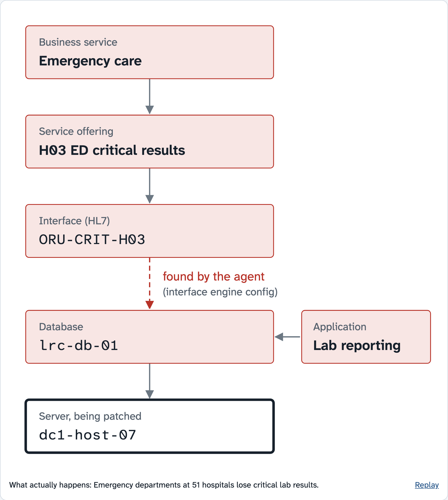

## The question every IT team asks

Imagine you're responsible for the computers that keep a hospital running. Tonight you need to install a security update on one server and restart it. Before you do, you ask one question:

**"What will break if I do this?"**

You don't guess. You open the **CMDB**, the *configuration management database*. Think of it as the hospital's map of its own IT: every server, database and application, and, most importantly, **what depends on what**. You look up the server, follow the lines on the map, and see what sits on top of it. That list is called the **blast radius**: everything that stops working if this one thing goes down.

The map says only one thing is affected: lab reporting. Low risk. You approve the change.

And at 2 a.m., Emergency departments across the region stop receiving critical lab results.

## Why the map was wrong

The map wasn't wrong when someone drew it. It went out of date.

Companies change their systems every week. New connections are added for a project, a quick fix, a new hospital coming online. Someone means to update the CMDB, and doesn't. This slow gap between **what the map says** and **what actually happens** has a name: **CMDB drift**.

> **Why doesn't anyone just keep it updated?**
> Most of the map *is* filled in automatically. *Discovery tools* scan the network and register servers and the connections they can see. But some of the most important links don't show up on the network the way a scanner expects. They live **inside an application's configuration**: for example, a setting in a hospital's message hub that says "store every critical lab result in this database." No scanner reads that setting, so the link never reaches the map.

This isn't a rare problem. Gartner has warned that organisations which don't deal with CMDB data quality end up with visible business disruptions. And the person approving the change has no way to know which lines are missing, because a missing line looks exactly like no line at all.

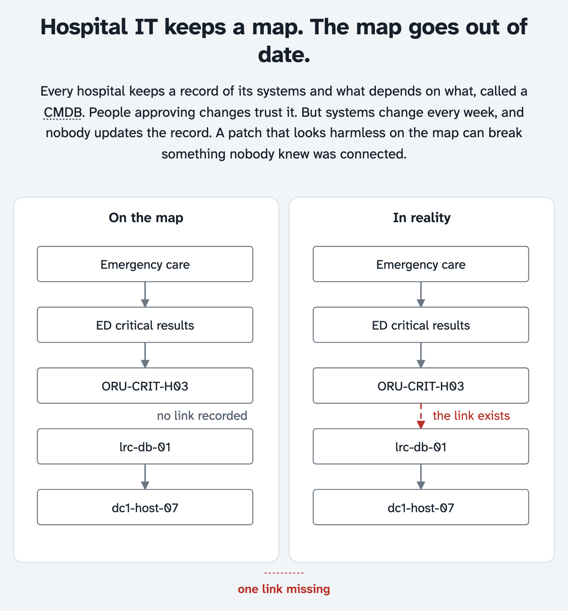

## What I built

**Change Guardian** is an AI agent that checks every change against **what systems actually do**, not just what the map says. It finds the links nobody recorded, shows the real blast radius, explains *why* with the exact path, and then acts: it warns the right people and proposes a fix to the map that a person approves.

To show it working, I needed a realistic world. I couldn't use a real hospital's data (and shouldn't), so I built **Northwind Health**, a fictional hospital system sized like a large real one: **51 hospitals**, about 1,000 clinics, two data centres and two cloud regions. Every layer is there, from the services patients notice down to servers, storage, network gear and medical devices.

> **Why a hospital?**
> Because the question "what really depends on what?" matters most where mistakes hurt people. In an online shop, a hidden dependency means a slow checkout. In a hospital, it means a doctor waiting for a lab result.

## Where the truth comes from: evidence

The agent's view of "what actually happens" comes from **evidence**: records from the tools a real hospital already runs. I built ten of them, plus the CMDB itself, and each one produces data in its **real tool's format**, so the system has to read them the way it would in real life:

- **Discovery scans** list every device on the network.
- **Application monitoring** shows which applications call which databases.
- **Network flow records** show who talks to whom, even devices with no software on them.
- **The interface engine**, the hub that routes medical messages between systems, shows where those messages actually go.
- **Backup and storage reports** show whether data really has a safe copy somewhere else.
- **Sign-in and database audit logs**, an **HR feed** and the **IT service desk history** show who uses what, and which team really fixes each system.

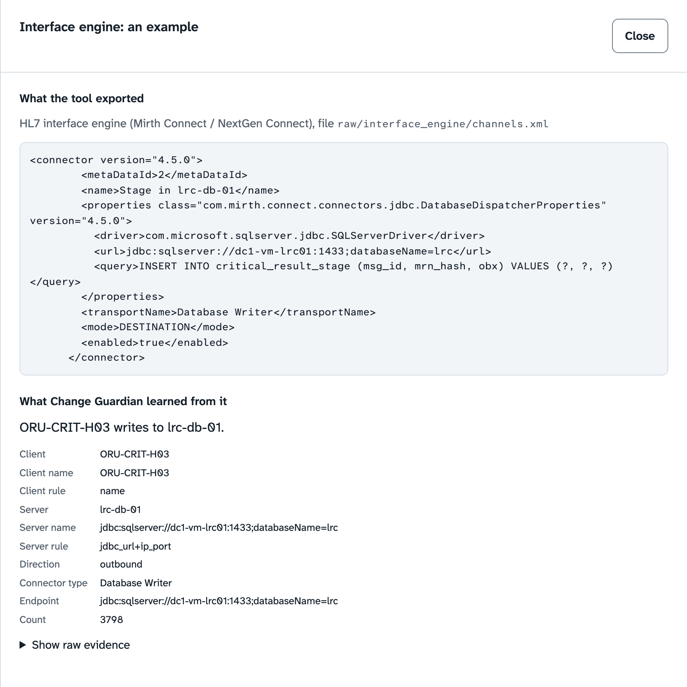

> **Why so many sources?**
> No single tool sees everything. The network sees traffic but not intentions. The interface engine sees message routes but not servers. The service desk sees who fixes what, which often isn't who the map says owns it. The truth is in the *combination*.

## The headline example: one patch, 51 hospitals

Back to that security update. The change request says: **apply an ESXi security patch and reboot `dc1-host-07`.**

Here's the chain, from the bottom up:
- `dc1-host-07` is a **physical server**.
- On it runs a **virtual machine**, a software computer.
- On that runs a **database**, `lrc-db-01`.

The CMDB says this patch affects **4 components and no hospitals**.

The evidence says **107 components, at 51 hospitals**.

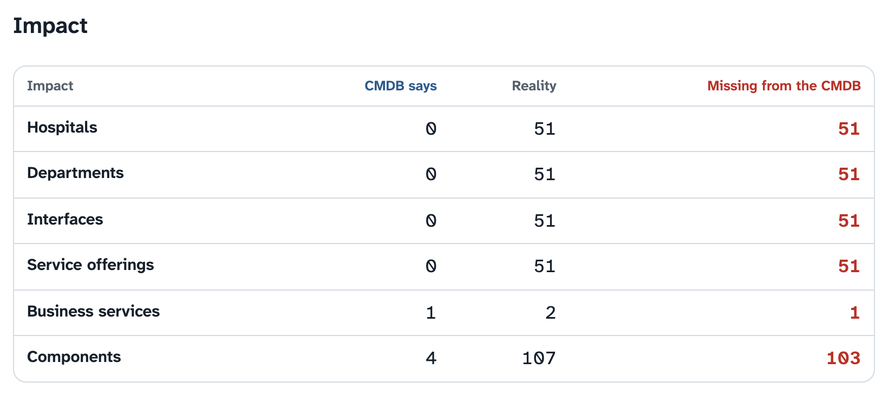

Why the difference? The CMDB has the hospitals' critical lab result *interfaces* (the feeds that carry urgent results to Emergency departments), and it has the database. What it's missing are **51 links between them**. The interface engine's configuration shows that every one of those 51 feeds writes into `lrc-db-01`, and it has seen this every day for 14 days. Nobody ever added those links to the map.

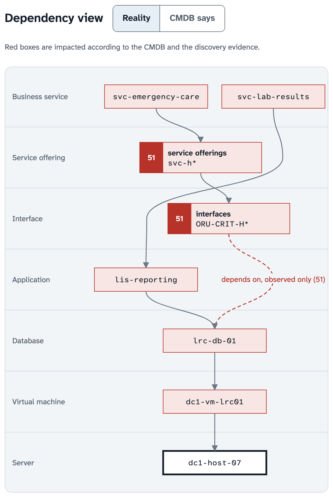

So the patch that looked like it touched lab reporting would actually cut off critical lab results to **the Emergency departments of all 51 hospitals**.

## Why a graph?

Here's where the database choice matters.

A dependency map is naturally a **graph**: things (servers, databases, services) are **nodes**, and "depends on" is an **edge** between them. Asking "what breaks if this fails?" means *walking* the edges: from the server to everything on it, to everything on those, and so on, sometimes many steps deep.

Change Guardian stores both versions of the truth in **one FalkorDB graph, on the same nodes, with two kinds of edges**: the ones the CMDB **declared**, and the ones the evidence **observed**. Then the question becomes two walks from the same starting point:

1. Walk only the declared edges: that's what the CMDB thinks will break.
2. Walk declared *and* observed edges: that's what will really break.

**The difference between the two walks *is* the finding**, and the path between them is the explanation, for free.

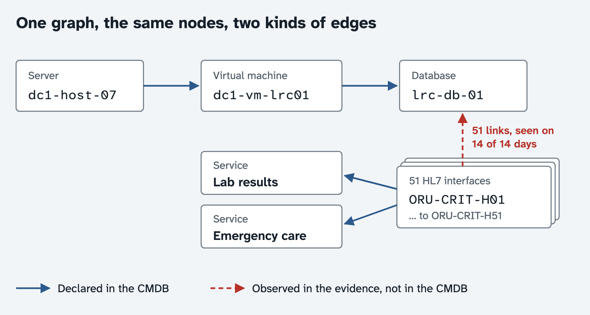

> **Why not just use an ordinary database with tables?**
> You can, and I tested it (more on that below). But with tables, every step of the walk is a "join" between tables, and a deep walk means many joins. In a graph, following an edge is the basic operation. The question "what depends on this, all the way up?" is one call.

## Why an agent, and not just code?

Finding drift itself is done by **plain, exact graph checks**. That's deliberate: detection must be precise and testable, and it is. Measured against an answer key, the checks find all 109 planted problems with no false alarms, including correctly *not* flagging four backup links that only look broken.

But reviewing a change isn't a fixed recipe. The next question depends on the last answer:

- Does the real impact differ from the declared one?
- If so, which links are hidden, and what evidence shows them?
- Who **really** owns the newly affected systems? (Often not who the map says.)
- Has anything else changed nearby recently?
- How risky is this, who should be warned, and what should happen next?

That's what an **agent** is for: an AI model that **decides its own next step**, uses tools to look things up, and keeps going until it can answer.

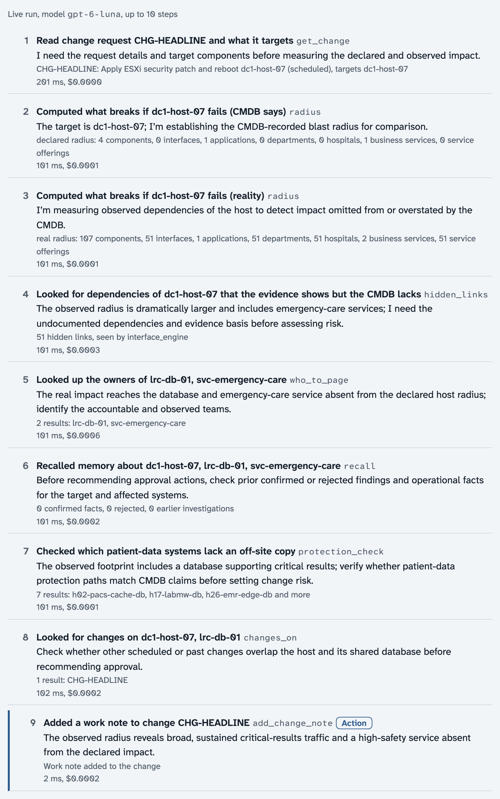

Change Guardian's agent:

- **Chooses its own steps.** It picks from 18 graph tools, one at a time, and says why at each step.
- **Uses tools through MCP.** The tools are served over the *Model Context Protocol*, an open standard for giving AI models tools. That means any MCP-compatible AI app can use the same graph tools too.
- **Acts.** It writes a note on the change and asks the change board to review it. Changes to the CMDB itself always wait for a person to approve.
- **Has its numbers checked.** Every number and system name in its verdict is checked against the graph. If something doesn't match, its answer is set aside and a rule-based review is shown instead.

For the headline change, the verdict is **high risk**, and it even catches a second problem: the CMDB says the Lab Systems team owns the database, but the team actually fixing its problems is a different one. The map would have warned the wrong people.

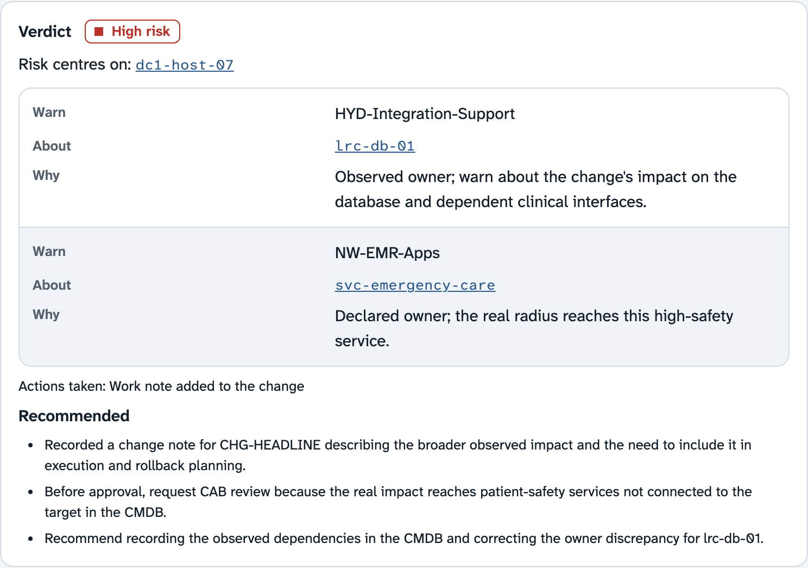

Each investigation costs **less than half a cent**.

## Why memory?

A person reviews the agent's proposed fix and approves it. The 51 missing links are added to the CMDB.

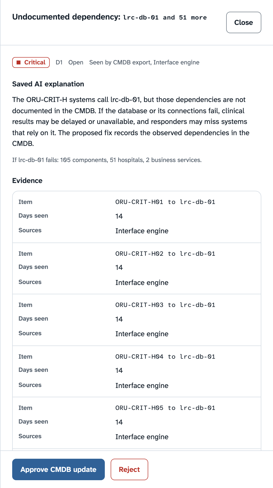

That approval is also stored in the agent's own **memory graph**, a separate graph in FalkorDB. The next time anyone reviews a change on this server, the agent already knows: *a person confirmed these 51 links.* And if a person *rejects* a finding as a false alarm, the agent won't raise it again.

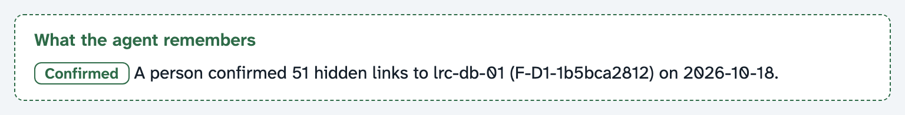

> **Why does this matter?**
> Without memory, every review starts from zero and people answer the same questions forever. With memory, human judgement accumulates instead of being lost.

## Did it actually work? Testing the agent honestly

It's easy to show an agent that works on the one example you built it for. So I wrote **nine test scenarios** with known answers: the headline patch, a failing backup, a wrong owner, an unregistered app reading patient records, data copied to the wrong country, and more.

Here's the honest part. The first five scenarios **shaped the agent**: its first run solved only 2 of 5, because it was missing two tools, and after I added them it solved 4 of 5. Scores you tune towards don't prove much. So I wrote **four more scenarios it had never seen**, saved their expected answers *before* running them, and ran them **once**, without changing anything afterwards.

On the final data, the agent got **7 of 9 right**.

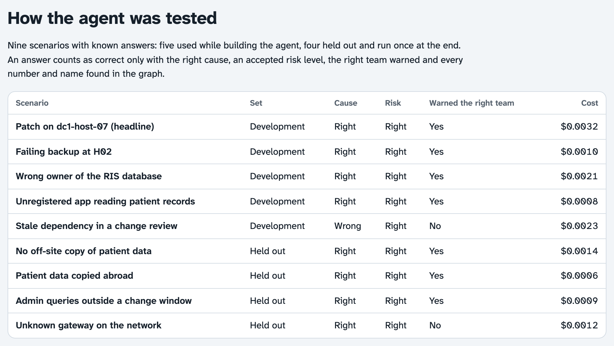

The two misses taught me the most. Both involved **warning the wrong team** (and in one case also naming the wrong cause). Ownership was the hardest thing for the agent to get right, which is fitting, because ownership is exactly what goes stale fastest in real CMDBs.

## Do you really need a graph? The benchmark

I'm a fresher, and I honestly assumed a graph database would be faster at everything. Rather than trust that, I tested it.

I ran the same questions on **FalkorDB** and on a carefully tuned **PostgreSQL** (a popular ordinary database), on the same data, from 49,000 up to **3.47 million** nodes, and checked that both always gave identical answers.

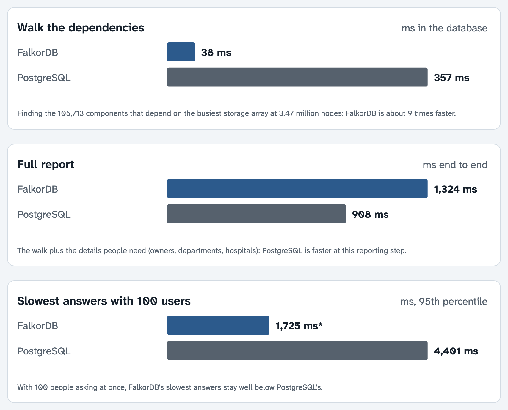

What I found:

- **Walking the dependencies: FalkorDB wins clearly.** Finding the 105,713 components that depend on the busiest storage array took **38 ms** in FalkorDB and **357 ms** in PostgreSQL, about nine times faster.
- **Many people at once: FalkorDB stays steadier.** With 100 users asking at the same time, FalkorDB's slowest answers stayed at **1.7 seconds**; PostgreSQL's reached **4.4 seconds**.
- **Building the full report: PostgreSQL wins.** Adding owners, departments and hospitals to 100,000 components is a "join and count" job, and tables are good at that: **908 ms** against FalkorDB's **1,324 ms**.
- **For the biggest changes, splitting the job was fastest:** FalkorDB walks, SQL fills in the details.

> **Why publish a result where the "other" database wins?**
> Because that's what the numbers said. The graph is the right tool for following dependencies, which is the heart of this product, and knowing exactly where it wins is more useful than pretending it wins everywhere.

## Things I didn't expect to learn

**Check your tools before you blame the database.** My first benchmark was unfair to FalkorDB: one missing library made its Python client read results slowly. Installing it made replies about three times faster to decode. I fixed it and published the correction.

**Measure under identical conditions.** A re-run once looked 2.7 times slower. The cause wasn't the database; my laptop was busy with other work. After that, I only published results measured back to back, under the same conditions.

**Graph algorithms can audit your own model.** I ran a *connected components* check (which finds groups of nodes that aren't linked to anything else) to look for orphaned systems. It found none, but it revealed whole families of services that nobody had connected to anything, which made some risky changes look harmless. I fixed the model.

**Hold out a test set, even for agents.** A score you committed to in advance is worth far more than one you tuned towards.

## What's next

Today, Change Guardian runs on fictional data. The next step is connecting it **read-only to a real CMDB**, and letting it review every change request the moment it's filed, so the warning arrives before anyone approves the change, not after the outage.

Because the most dangerous dependency is the one nobody wrote down.

---

**Watch the demo:** https://youtu.be/FjRZv8ZxBCE
**Try it:** https://change-guardian.vercel.app (start with "Watch it review a change")
**Read the code, the benchmark and the evaluation:** https://github.com/sudarshan032/northwind-drift-agent

*All data is fictional; Northwind Health is an invented hospital system. Built with Claude Code as a coding assistant. Thanks to WeMakeDevs and FalkorDB for Graph Hacks 2026.*